<!--
  FORMATTING NOTES FOR CONVERSION TO WORD (follow "Thesis Format_Dissertation-I_MDT.docx"):
  * Page: A4, 1-inch (2.54 cm) margins on all sides; font Verdana; body 12 pt, justified, 1.5 line spacing.
  * Chapter headings 14 pt bold, centred; section headings 12 pt bold.
  * Front matter (Declaration to List of Abbreviations) uses Roman page numbers; Chapter 1 starts at page 1.
  * Figure captions are centred BELOW each figure ("Figure n"); table captions are centred ABOVE each table ("Table n").
  * All figure image files are in the folder  thesis/figures/  and are named  Figure_<number>_<title>.png .
  * Replace every item in [square brackets] (student name, registration number, guide name) before submission.
  * Generate the Contents, List of Figures and List of Tables page numbers with Word's References tools after conversion.
-->

<div align="center" markdown="1">


# MULTIVARIATE TIME SERIES ANALYSIS FOR FORECASTING TRENDS IN THE CIVIL AVIATION INDUSTRY

Submitted in partial fulfillment of the requirements for the degree of

## Master of Science

in

## **Data Science**

by

### [Name of the Student]
### [Registration Number]

**Under the guidance of**

### **[Dr. Name of the Guide]**

**School of Advanced Sciences**

**VIT – Vellore**

November, 2026

</div>

<div style="page-break-after: always;"></div>

<div align="center" markdown="1">

## DECLARATION

</div>

I hereby declare that the thesis entitled **"Multivariate Time Series Analysis for Forecasting Trends in the Civil Aviation Industry"** submitted by me, for the award of the degree of *Master of Science in Data Science* to VIT is a record of bonafide work carried out by me under the supervision of **[Dr. Name of the Guide]**.

I further declare that the work reported in this thesis has not been submitted and will not be submitted, either in part or in full, for the award of any other degree or diploma in this institute or any other institute or university.

**Place:** Vellore

**Date:**

<div align="right" markdown="1">

**Signature of the Candidate**

**[Name of the Student]**

</div>

<div style="page-break-after: always;"></div>

<div align="center" markdown="1">

## CERTIFICATE

</div>

This is to certify that the thesis entitled **"Multivariate Time Series Analysis for Forecasting Trends in the Civil Aviation Industry"** submitted by **[Name of the Student] (Reg. No.: [Registration Number])**, School of Advanced Sciences, VIT, for the award of the degree of *Master of Science in Data Science*, is a record of bonafide work carried out by him / her under my supervision during the period, 06.07.2026 to 30.10.2026, as per the VIT code of academic and research ethics.

The contents of this report have not been submitted and will not be submitted either in part or in full, for the award of any other degree or diploma in this institute or any other institute or university. The thesis fulfills the requirements and regulations of the University and in my opinion meets the necessary standards for submission.

**Place:** Vellore

**Date:**

<div align="right" markdown="1">

**Signature of the Guide**

**[Dr. Name of the Guide]**

Department of Mathematics, SAS, VIT – Vellore

</div>

**Name & Signature of the Examiner**

<div align="center" markdown="1">

**Dr. KHADARBABU S K**

**Head, Department of Mathematics**

**SAS, VIT – Vellore**

</div>

<div style="page-break-after: always;"></div>

<div align="center" markdown="1">

## ACKNOWLEDGEMENT

</div>

With immense pleasure and deep sense of gratitude, I wish to express my sincere thanks to my guide **[Dr. Name of the Guide]**, School of Advanced Sciences, VIT, Vellore, without whose motivation and continuous encouragement this research would not have been successfully completed.

I am grateful to the Chancellor of VIT, Vellore, Dr. G. Viswanathan, the Vice Presidents and the Vice Chancellor for motivating me to carry out research in the Vellore Institute of Technology, Vellore and also for providing me with infrastructural facilities and many other resources needed for my research.

I express my sincere thanks to Dr. Karthikeyan K, Dean, School of Advanced Sciences, VIT, Vellore, for the kind words of support and encouragement. I like to acknowledge the support rendered by my classmates in several ways throughout my research work.

I wish to thank Dr. KHADAR BABU S K, Head of the Department of Mathematics, School of Advanced Sciences, VIT, Vellore for his encouragement and support.

I also thank the maintainers of the open *india-aviation-traffic* repository, who compiled the Directorate General of Civil Aviation traffic statistics into machine-readable form, and the developers of the open-source Python libraries used in this work.

I wish to extend my profound sense of gratitude to my parents and friends for all the support they made during my research and also for providing me with encouragement whenever required.

<div align="right" markdown="1">

**Signature of the Student**

**[Name of the Student]**

</div>

<div style="page-break-after: always;"></div>

<div align="center" markdown="1">

## ABSTRACT

</div>

International air traffic is a sensitive indicator of tourism, migration, trade and economic connectivity, and reliable short-term forecasts of passenger demand support airport capacity planning, airline scheduling and policy decisions. This project analyses quarterly international passenger and freight traffic between India and 91 partner countries, compiled from Directorate General of Civil Aviation (DGCA) statistics, and develops a reproducible forecasting framework for the number of passengers arriving in India (*PaxToIndia*). The study uses 2,544 country–quarter records covering 2015 Q1 to 2026 Q2, which are validated, harmonised and aggregated into a regular series of 46 quarterly observations of four variables: passengers to India, passengers from India, freight to India and freight from India.

Exploratory analysis shows steady pre-pandemic growth (annual arrivals rose 33.1% from 2015 to 2019), a collapse of 95.1% between 2020 Q1 and 2020 Q2, and a recovery that carried annual arrivals to 38.33 million in 2025, 21.1% above the 2019 level. The series has a strong trend (trend strength 0.95) and moderate quarterly seasonality (seasonal strength 0.39) with a fourth-quarter peak. Augmented Dickey–Fuller tests do not reject a unit root for any series in levels (p = 0.127 to 0.561) but reject it for every first difference (p < 0.001), which supports first differencing. The four traffic variables are strongly correlated (r = 0.70 to 0.98), and the United Arab Emirates alone accounts for 31.7% of arrivals.

Three model families are compared: a Seasonal Naive benchmark, Seasonal ARIMA with optional exogenous regressors (SARIMAX) and a Vector Autoregression (VAR) on log differences. Models are assessed by leakage-free, expanding-window rolling-origin evaluation over the same 12 quarters (2023 Q3 – 2026 Q2). The univariate SARIMAX(1,1,1)(1,1,0,4) gives the lowest operational error (MAE 356,699 passengers; MAPE 4.08%), 61.2% below the Seasonal Naive benchmark (MAE 920,135; MAPE 10.47%). The VAR(1) (MAE 880,632) and a SARIMAX using projected exogenous regressors (MAE 821,123) improve only marginally on the benchmark. A SARIMAX fed with the *observed* future regressors reaches MAE 201,148, but this conditional result is not achievable in real forecasting and is reported separately. An eight-quarter forecast from 2026 Q3 to 2028 Q2 is produced with 95% prediction intervals that widen from 5.76 million to 29.28 million passengers, underlining the uncertainty of a short series containing a structural break.

All methods are implemented in a modular Python package and delivered through a ten-page interactive Streamlit dashboard with data validation, exploratory analysis, diagnostics, model comparison, forecasting, residual analysis and automated PDF/Markdown/JSON reporting, verified by 73 automated tests.

**Keywords:** civil aviation, air passenger demand, multivariate time series, SARIMAX, vector autoregression, rolling-origin evaluation, forecasting, Streamlit dashboard.

<div style="page-break-after: always;"></div>

<div align="center" markdown="1">

## CONTENTS

</div>

| Chapter | Title | Page No. |
|---|---|---|
| | Declaration | ii |
| | Certificate | iii |
| | Acknowledgement | iv |
| | Abstract | v |
| | List of Figures | viii |
| | List of Tables | x |
| | List of Abbreviations | xi |
| 1 | **INTRODUCTION** | 1 |
| | 1.1 Objective | 1 |
| | 1.2 Motivation | 2 |
| | 1.3 Background | 3 |
| | 1.4 Problem Statement | 6 |
| | 1.5 Research Questions | 6 |
| | 1.6 Scope of the Study | 7 |
| | 1.7 Organisation of the Thesis | 7 |
| 2 | **PROJECT DESCRIPTION AND GOALS** | 8 |
| | 2.1 Project Description | 8 |
| | 2.2 Project Goals | 9 |
| | 2.3 Dataset Description | 9 |
| | 2.4 Expected Outcomes | 12 |
| 3 | **TECHNICAL SPECIFICATIONS** | 13 |
| | 3.1 Hardware and Software Environment | 13 |
| | 3.2 Python Libraries | 13 |
| | 3.3 System Architecture | 15 |
| | 3.4 Project Structure | 16 |
| | 3.5 Configuration and Deployment | 17 |
| 4 | **DESIGN APPROACH AND DETAILS** | 18 |
| | 4.1 Materials, Approach and Methods | 18 |
| | 4.2 Codes and Standards | 30 |
| 5 | **SCHEDULE, TASKS AND MILESTONES** | 37 |
| 6 | **PROJECT OUTPUTS** | 39 |
| | 6.1 Traffic Trends and Growth | 39 |
| | 6.2 Seasonality and Distribution | 44 |
| | 6.3 Relationships and Country Composition | 47 |
| | 6.4 Decomposition and Time-Series Diagnostics | 50 |
| | 6.5 Model Fitting and Evaluation | 54 |
| | 6.6 Future Forecasts | 58 |
| | 6.7 Residual Diagnostics | 61 |
| | 6.8 Interactive Dashboard | 62 |
| 7 | **RESULTS AND DISCUSSION** | 67 |
| 8 | **LIMITATIONS** | 82 |
| 9 | **CONCLUSION AND FUTURE WORK** | 84 |
| | **REFERENCES** | 86 |
| | Appendix A – Dashboard User Guide | 89 |
| | Appendix B – Rolling-Origin Forecasts of All Models | 91 |

<!-- Page numbers above are indicative; regenerate them in Word (References → Table of Contents) after inserting the figures. -->

<div style="page-break-after: always;"></div>

<div align="center" markdown="1">

## LIST OF FIGURES

</div>

| Figure No. | Title | Image file (thesis/figures/) |
|---|---|---|
| 1 | System architecture of the analytics and forecasting platform | Figure_01_System_Architecture.png |
| 2 | Methodology workflow followed in the project | Figure_02_Methodology_Workflow.png |
| 3 | Expanding-window rolling-origin evaluation scheme | Figure_03_Rolling_Origin_Scheme.png |
| 4 | Project schedule as a Gantt chart | Figure_04_Project_Schedule_Gantt.png |
| 5 | Quarterly passenger traffic to and from India, 2015 Q1 – 2026 Q2 | Figure_05_Passenger_Traffic_Trends.png |
| 6 | Quarterly freight traffic to and from India, 2015 Q1 – 2026 Q2 | Figure_06_Freight_Traffic_Trends.png |
| 7 | Passengers to India with a four-quarter moving average | Figure_07_PaxToIndia_Moving_Average.png |
| 8 | Quarter-over-quarter change in passengers to India | Figure_08_PaxToIndia_QoQ_Growth.png |
| 9 | Year-over-year change in passengers to India | Figure_09_PaxToIndia_YoY_Growth.png |
| 10 | Annual passenger traffic totals | Figure_10_Annual_Passenger_Traffic.png |
| 11 | Annual freight traffic totals | Figure_11_Annual_Freight_Traffic.png |
| 12 | Passengers to India by quarter and year | Figure_12_Quarterly_Seasonal_Comparison.png |
| 13 | Distribution of passengers to India by quarter of year | Figure_13_Quarter_of_Year_Boxplot.png |
| 14 | Histograms of the four quarterly traffic variables | Figure_14_Variable_Distributions.png |
| 15 | Pearson correlation matrix of the traffic variables (levels) | Figure_15_Correlation_Heatmap_Levels.png |
| 16 | Pearson correlation matrix of the traffic variables (quarter-over-quarter log changes) | Figure_16_Correlation_Heatmap_Log_Changes.png |
| 17 | Scatter-plot matrix of the four quarterly traffic variables | Figure_17_Scatter_Matrix.png |
| 18 | Top 15 countries by total passengers to India | Figure_18_Top_Countries.png |
| 19 | Quarterly share of passengers to India for the five largest origin countries | Figure_19_Top_Country_Shares.png |
| 20 | Additive seasonal decomposition of passengers to India | Figure_20_Seasonal_Decomposition_PaxToIndia.png |
| 21 | Additive seasonal decomposition of freight to India | Figure_21_Seasonal_Decomposition_FreightToIndia.png |
| 22 | ACF and PACF of passengers to India (level) | Figure_22_ACF_PACF_Level.png |
| 23 | ACF and PACF of passengers to India (first difference) | Figure_23_ACF_PACF_First_difference.png |
| 24 | Seasonal sub-series plot of passengers to India | Figure_24_Seasonal_Subseries.png |
| 25 | SARIMAX(1,1,1)(1,1,0,4) actual versus in-sample fitted values | Figure_25_SARIMAX_Fitted_vs_Actual.png |
| 26 | Rolling-origin one-step forecasts of Seasonal Naive, SARIMAX and VAR against actual values | Figure_26_Rolling_Actual_vs_Predicted.png |
| 27 | Conditional versus operational SARIMAX with exogenous regressors | Figure_27_Exogenous_Conditional_vs_Operational.png |
| 28 | MAE, RMSE and MAPE of the five model variants | Figure_28_Model_Error_Metrics.png |
| 29 | Per-quarter rolling forecast errors (actual − predicted) | Figure_29_Per_Quarter_Errors.png |
| 30 | Distribution of rolling forecast errors by model | Figure_30_Error_Distribution.png |
| 31 | Rolling-origin MAE of alternative SARIMAX orders | Figure_31_SARIMAX_Order_Screening.png |
| 32 | Eight-quarter forecast from SARIMAX(1,1,1)(1,1,0,4) with 95% prediction interval | Figure_32_Future_Forecast_SARIMAX.png |
| 33 | Eight-quarter forecast from SARIMAX fitted to log values, with 95% prediction interval | Figure_33_Future_Forecast_Log_SARIMAX.png |
| 34 | Comparison of eight-quarter point forecasts from the four future-capable models | Figure_34_Future_Forecast_Model_Comparison.png |
| 35 | Width of the 95% prediction interval relative to the point forecast, by horizon | Figure_35_Interval_Width_by_Horizon.png |
| 36 | In-sample residual diagnostics of SARIMAX(1,1,1)(1,1,0,4) | Figure_36_SARIMAX_Residual_Diagnostics.png |
| 37 | Diagnostics of SARIMAX rolling-origin forecast errors | Figure_37_SARIMAX_Rolling_Error_Diagnostics.png |
| 38 | Dashboard – Executive Dashboard page | Figure_38_Dashboard_Executive_Dashboard.png |
| 39 | Dashboard – Dataset Explorer page | Figure_39_Dashboard_Dataset_Explorer.png |
| 40 | Dashboard – Exploratory Analysis page | Figure_40_Dashboard_Exploratory_Analysis.png |
| 41 | Dashboard – Time-Series Diagnostics page | Figure_41_Dashboard_Time_Series_Diagnostics.png |
| 42 | Dashboard – Forecasting Laboratory page | Figure_42_Dashboard_Forecasting_Laboratory.png |
| 43 | Dashboard – Model Evaluation page | Figure_43_Dashboard_Model_Evaluation.png |
| 44 | Dashboard – Future Forecast page | Figure_44_Dashboard_Future_Forecast.png |
| 45 | Dashboard – Residual Analysis page | Figure_45_Dashboard_Residual_Analysis.png |
| 46 | Dashboard – Reports & Downloads page | Figure_46_Dashboard_Reports_and_Downloads.png |

<div style="page-break-after: always;"></div>

<div align="center" markdown="1">

## LIST OF TABLES

</div>

| Table No. | Title |
|---|---|
| 1 | Variables of the country-level source dataset |
| 2 | Sample of the raw country-level records |
| 3 | First and last quarters of the aggregated quarterly dataset |
| 4 | Hardware and software environment |
| 5 | Python libraries and their role in the project |
| 6 | Modules of the analytics package |
| 7 | Data-quality checks and their outcome |
| 8 | Model specifications and default parameters |
| 9 | Automated test suite summary |
| 10 | Schedule, tasks and milestones |
| 11 | Dashboard pages and functions |
| 12 | Annual traffic totals, 2015 – 2026 |
| 13 | Descriptive statistics of the quarterly traffic variables |
| 14 | Average passengers to India by quarter of year |
| 15 | Seasonal decomposition summary (additive, period 4) |
| 16 | Pearson correlation matrix (levels / quarter-over-quarter log changes) |
| 17 | Top 15 countries by passengers to India (2015 Q1 – 2026 Q2) |
| 18 | Augmented Dickey–Fuller test results (constant only; 5% critical value ≈ −2.93) |
| 19 | Estimated SARIMAX(1,1,1)(1,1,0,4) parameters (full sample) |
| 20 | Rolling-origin evaluation metrics of all models (12 one-step forecasts, 2023 Q3 – 2026 Q2) |
| 21 | Rolling-origin MAE of alternative SARIMAX orders (same 12 quarters) |
| 22 | Eight-quarter SARIMAX forecast of passengers to India (95% prediction interval) |
| 23 | Point forecasts of all future-capable models (millions of passengers) |
| 24 | Forecast validation checks (SARIMAX forecast) |
| 25 | Residual and forecast-error diagnostic tests (SARIMAX) |
| 26 | Reproduction of the notebook results by the dashboard |
| 27 | Rolling-origin one-step forecasts of all models (passengers to India) |

<div style="page-break-after: always;"></div>

<div align="center" markdown="1">

## LIST OF ABBREVIATIONS

</div>

| Abbreviation | Expansion |
|---|---|
| ACF | Autocorrelation Function |
| ADF | Augmented Dickey–Fuller (test) |
| AIC | Akaike Information Criterion |
| API | Application Programming Interface |
| AR | Autoregressive |
| ARIMA | Autoregressive Integrated Moving Average |
| BIC | Bayesian (Schwarz) Information Criterion |
| CSV | Comma-Separated Values |
| CV | Coefficient of Variation |
| DGCA | Directorate General of Civil Aviation (India) |
| EDA | Exploratory Data Analysis |
| ICAO | International Civil Aviation Organization |
| IQR | Interquartile Range |
| JSON | JavaScript Object Notation |
| MA | Moving Average |
| MAE | Mean Absolute Error |
| MAPE | Mean Absolute Percentage Error |
| PACF | Partial Autocorrelation Function |
| PDF | Portable Document Format |
| QoQ | Quarter-over-Quarter |
| RMSE | Root Mean Squared Error |
| SARIMA | Seasonal Autoregressive Integrated Moving Average |
| SARIMAX | Seasonal ARIMA with eXogenous regressors |
| sMAPE | Symmetric Mean Absolute Percentage Error |
| UAE | United Arab Emirates |
| UI | User Interface |
| VAR | Vector Autoregression |
| YoY | Year-over-Year |

<div style="page-break-after: always;"></div>
<div align="center" markdown="1">

# CHAPTER 1

# INTRODUCTION

</div>

International civil aviation connects economies, families and markets. For India, which is both a major source and a major destination of international travel, the number of passengers and the volume of cargo moving across its borders by air reflect changes in tourism, labour migration, business activity and trade policy. Airports, airlines, government agencies and tourism boards all depend on forward-looking estimates of this traffic to plan terminal capacity, schedule aircraft, allocate immigration staff and evaluate policy. Because these decisions are made months in advance, forecasting quarterly traffic accurately, and communicating how uncertain those forecasts are, is a practical problem with real consequences.

The past decade has made this problem harder. Indian international traffic grew steadily until 2019, collapsed almost entirely in 2020 when travel restrictions were introduced during the COVID-19 pandemic, and then recovered over 2021–2023 to exceed its pre-pandemic level. A forecasting method for such a series must cope with trend, seasonality and an extreme structural break while working with only a few dozen quarterly observations. This thesis studies that problem using publicly available DGCA statistics and builds an end-to-end, reproducible analytics and forecasting platform around it.

## 1.1 OBJECTIVE

The main objective of this project is to analyse historical international passenger and freight traffic involving India and to develop, evaluate and deploy multivariate time-series models for forecasting quarterly passenger arrivals. The specific objectives are:

1. To construct a validated quarterly dataset of international passenger and freight traffic from country-level DGCA records, with every cleaning decision documented.
2. To describe the trend, growth, seasonality, distribution and inter-relationships of passengers to India, passengers from India, freight to India and freight from India over 2015–2026.
3. To test the statistical properties of the series, namely stationarity, autocorrelation structure and seasonal strength, and to choose suitable transformations.
4. To build and compare three model families, Seasonal Naive, SARIMAX (with and without exogenous variables) and Vector Autoregression, for forecasting passengers to India.
5. To evaluate these models fairly, using time-ordered, expanding-window rolling-origin evaluation that prevents information from the future leaking into the training data.
6. To produce an eight-quarter forecast with prediction intervals and to interpret its uncertainty honestly.
7. To deliver the complete workflow as an interactive web dashboard with automated reporting, so that the analysis can be reproduced, explored and extended by others.

## 1.2 MOTIVATION

The motivation for this work comes from three directions.

**Practical relevance.** India's international air traffic has grown into one of the largest in the world, and its Gulf, South-East Asian and European corridors carry large flows of workers, tourists and business travellers. Capacity expansion at Indian airports and the bilateral air-service agreements negotiated by the government both depend on credible demand projections. A transparent, data-driven forecast of arrivals is directly useful to these stakeholders.

**Methodological interest.** Aviation traffic is a textbook example of a seasonal, trending time series, yet the pandemic turned it into a difficult real-world test case: a short sample with a deep structural break, strong co-movement between related series, and a recent regime that may differ from the past. It is an ideal setting for learning how classical models such as SARIMAX and VAR behave in practice, how much of an improvement they offer over a simple benchmark, and how easily an evaluation can be made misleading by using information that would not be available at forecast time.

**Reproducibility and communication.** Many student and industry forecasting studies end as a static notebook whose figures cannot be regenerated and whose numbers cannot be checked. This project set out to build a complete pipeline, from raw CSV to validated data, statistical tests, models, evaluation, forecasts and a report, in which every number is computed from the data, every chart can be regenerated, and decision makers can explore the results interactively without writing code. Building such a system exercises the full range of data-science skills: data engineering, statistics, machine learning, software engineering, testing and visualisation.

## 1.3 BACKGROUND

### 1.3.1 Air-traffic demand forecasting

Forecasting air passenger demand has a long history. Box and Jenkins used a monthly series of international airline passengers to illustrate the seasonal ARIMA model, and the "airline model", ARIMA(0,1,1)(0,1,1)<sub>12</sub> on log values, remains a standard benchmark [1]. The approach models a series as the output of a linear filter applied to white noise after differencing removes trend and seasonality. Its strengths are a small number of parameters, explicit prediction intervals and good performance on short horizons.

Later studies compared ARIMA-type models with exponential smoothing and regression approaches. Grubb and Mason [12] forecast UK air passengers with Holt–Winters methods and a damped trend for long lead times, showing that simple smoothing methods can be competitive when the trend is handled carefully. Tsui et al. [13] forecast passenger throughput at Hong Kong International Airport with SARIMA and ARIMAX models and found that seasonal ARIMA structures captured the dynamics well, while explanatory variables helped only when their own future values could be predicted reliably. Dantas et al. [14] combined bootstrap aggregation with Holt–Winters methods and reported gains in accuracy for air transportation demand. These studies share two lessons used in this project: seasonal models are a strong default for aviation series, and exogenous regressors are only useful in practice if they are themselves known or forecastable at the time of the forecast.

### 1.3.2 Shocks, structural breaks and the COVID-19 pandemic

Large shocks challenge every statistical forecasting method because the models assume that the process generating the data is stable. The COVID-19 pandemic caused the deepest disruption in the history of civil aviation. The International Civil Aviation Organization documented a collapse of global passenger traffic in 2020 and a multi-year recovery [16]. Gudmundsson, Cattaneo and Redondi [15] modelled the recovery of world air transport markets after the COVID-19 shock and concluded that recovery paths differ by region and that pre-pandemic levels would take several years to regain. For a quarterly series that starts in 2015, the 2020–2021 observations make up almost one-fifth of the sample, so any model fitted to the full data must cope with them, either by absorbing them into its error variance or by being evaluated only on post-recovery periods. This project does both: models are fitted on the full history, but they are evaluated on the 12 most recent quarters, after the recovery.

### 1.3.3 Univariate and multivariate time-series models

The SARIMA model extends ARIMA with seasonal autoregressive and moving-average terms at the seasonal lag and with seasonal differencing [1, 2]. SARIMAX additionally allows exogenous regressors, which in this project are the other three traffic series. When several related series are available, the Vector Autoregression proposed by Sims [7] models each series as a linear function of past values of all series. Lütkepohl [6] gives a complete treatment of estimation, lag selection and forecasting with VAR models, and stresses that the number of parameters grows with the square of the number of variables. With four variables and a few dozen observations, over-parameterisation is a real risk, which is why this project restricts the VAR lag order by sample size.

Stationarity is a central assumption of ARMA-type models. The Dickey–Fuller test [3] and its augmented form by Said and Dickey [4] test the null hypothesis that a series has a unit root. Model order is commonly guided by the autocorrelation and partial autocorrelation functions [1] and by information criteria such as AIC [27] and BIC [28]. Residual adequacy is checked with the Ljung–Box portmanteau test [5] and with normality tests such as Shapiro–Wilk [29] and Jarque–Bera [30].

### 1.3.4 Forecast evaluation

How a model is evaluated matters as much as which model is chosen. Tashman [8] reviewed out-of-sample evaluation and recommended rolling-origin (time-series cross-validation) designs, in which the forecast origin moves forward through the test period and each forecast uses only data available at its origin. Hyndman and Koehler [9] compared accuracy measures, explaining why scale-dependent measures (MAE, RMSE) and percentage measures (MAPE, sMAPE) answer different questions, and why percentage errors are undefined when actual values are zero. The large M-competitions organised by Makridakis and colleagues [10, 11] repeatedly found that simple benchmarks such as the seasonal naive method are surprisingly hard to beat, and that complex methods must be compared against them on identical test periods. These findings shape the evaluation design of this project: every model is compared with a Seasonal Naive benchmark on the same 12 rolling forecast origins.

### 1.3.5 Decomposition and seasonality measures

Classical and STL decomposition [26] split a series into trend, seasonal and remainder components. Wang, Smith and Hyndman [31] proposed measures of trend and seasonal strength based on the variance of the remainder relative to the de-trended and de-seasonalised series; these measures, bounded between 0 and 1, are used in this project to quantify how seasonal each traffic series is.

### 1.3.6 Tools for reproducible analysis

The Python scientific stack (NumPy [20], pandas [18], SciPy [21] and statsmodels [17]) provides tested implementations of the statistical methods above, Matplotlib [19] and Plotly [22] provide static and interactive graphics, and Streamlit [23] allows an analysis to be published as an interactive web application written entirely in Python. Together they make it practical to build a forecasting system whose every number can be regenerated from source data.

### 1.3.7 Research gap

Published aviation forecasting studies usually report a single model fitted to one airport or one country's total traffic, often evaluated on a single hold-out split, and rarely discuss whether the explanatory variables used in the evaluation would actually be known at forecast time. Studies of India's international traffic that span the pandemic and its recovery are rare, and to the author's knowledge none publishes the complete pipeline as a reproducible, interactive tool. This project addresses that gap by combining (i) a validated country-level dataset that runs to 2026 Q2, (ii) a fair rolling-origin comparison of univariate and multivariate models against a benchmark, (iii) an explicit distinction between *conditional* and *operational* use of exogenous variables, and (iv) an open, tested dashboard that reproduces every result.

## 1.4 PROBLEM STATEMENT

Given quarterly counts of international passengers and freight between India and partner countries from 2015 Q1 to the latest available quarter, the problem is to:

- determine the trend, seasonal and cross-variable structure of the traffic series, including the effect of the 2020–2021 disruption;
- identify which forecasting approach, from a seasonal benchmark, a seasonal ARIMA model with or without explanatory traffic variables, and a multivariate VAR, produces the most accurate one-quarter-ahead forecasts of passengers arriving in India when evaluated without look-ahead bias; and
- forecast passenger arrivals for the next eight quarters together with a realistic statement of forecast uncertainty,

and to package this analysis so that it can be reproduced and explored interactively.

## 1.5 RESEARCH QUESTIONS

The project answers the following research questions:

- **RQ1.** How did international passenger and freight traffic involving India evolve between 2015 and 2026, and how large were the pandemic collapse and the subsequent recovery?
- **RQ2.** How strong are the trend and the quarterly seasonality of the series, and which quarter of the year carries peak traffic?
- **RQ3.** Are the series stationary, and what transformation is needed before modelling?
- **RQ4.** How strongly are passenger and freight flows related, and is the relationship more than a shared trend?
- **RQ5.** Under leakage-free rolling-origin evaluation, does SARIMAX or VAR outperform the Seasonal Naive benchmark, and by how much?
- **RQ6.** Do the other traffic series improve the forecast of passenger arrivals when their future values must themselves be forecast?
- **RQ7.** What is the eight-quarter outlook for passenger arrivals, and how uncertain is it?

## 1.6 SCOPE OF THE STUDY

The study covers **international** scheduled traffic between India and other countries as published by DGCA and compiled in the *india-aviation-traffic* repository [24]. Domestic traffic, airport-level flows and airline-level statistics are outside the scope, although the repository contains them. The unit of analysis is the calendar quarter. The primary forecasting target is the number of passengers arriving in India (*PaxToIndia*); the three other series are used for exploratory analysis and as candidate explanatory variables. The models considered are linear statistical time-series models. Machine-learning and deep-learning models were deliberately excluded, because with 46 observations they would be difficult to train and validate reliably. The study forecasts traffic volumes and does not attempt to explain their economic causes.

## 1.7 ORGANISATION OF THE THESIS

The thesis follows the department's Dissertation-I format. **Chapter 2** describes the project, its goals and the dataset. **Chapter 3** lists the technical specifications and the system architecture. **Chapter 4** explains the design approach: data preparation, statistical methods, models, evaluation procedure, and the coding and testing standards adopted. **Chapter 5** gives the schedule and milestones. **Chapter 6** presents the project outputs, namely the figures produced by the analysis and the interactive dashboard. **Chapter 7** reports and discusses the results and answers the research questions. **Chapter 8** states the limitations, **Chapter 9** concludes and suggests future work, and the **References** and **Appendices** follow.

<div style="page-break-after: always;"></div>
<div align="center" markdown="1">

# CHAPTER 2

# PROJECT DESCRIPTION AND GOALS

</div>

## 2.1 PROJECT DESCRIPTION

This project studies the quarterly international air traffic of India, meaning passengers and freight carried between India and each partner country, from the first quarter of 2015 to the second quarter of 2026. The raw data are country-level quarterly records compiled from the traffic statistics of the Directorate General of Civil Aviation (DGCA) and published in the open *india-aviation-traffic* repository [24, 25]. Each record gives, for one country and one quarter, the number of passengers flown to India and from India and the freight carried in each direction.

The work proceeds in two connected streams.

The **analytical stream** turns the raw records into a validated quarterly series and studies it statistically. It covers data validation and cleaning, quarterly aggregation, exploratory analysis of trends, growth and seasonality, correlation analysis, seasonal decomposition, stationarity testing with the Augmented Dickey–Fuller test, autocorrelation analysis, and finally forecasting. Three model families are developed:

- a **Seasonal Naive** benchmark, which repeats the value of the same quarter one year earlier;
- **SARIMAX**, a seasonal ARIMA model that can also use the other traffic series as exogenous regressors; and
- a **Vector Autoregression (VAR)** that models the four traffic series jointly.

The models are compared by expanding-window rolling-origin evaluation over the 12 most recent quarters, and the best operational model produces an eight-quarter forecast with 95% prediction intervals. Residuals of the fitted models and errors of the rolling forecasts are diagnosed separately.

The **engineering stream** packages the analysis as a modular Python library (`src/`) and a ten-page Streamlit dashboard. The dashboard lets a user load the default data, upload a new CSV file or refresh the data from the source repository. It validates the data and reports every issue, filters by date range and country, and explores the data through interactive Plotly charts. It also runs the statistical tests, configures and fits models, compares them, inspects forecasts and residuals, and exports a complete report as PDF, Markdown, JSON or a ZIP archive. The project's earlier Jupyter notebook (`notebooks/civil_aviation_forecasting.ipynb`) is retained, and its saved results are reproduced exactly by the new code (Section 7.10).

## 2.2 PROJECT GOALS

The goals that guided the work are listed below; each is revisited in Chapter 7.

1. Finding the change in passenger and freight traffic over time, including the size of the pandemic collapse and recovery.
2. Finding quarter-over-quarter and year-over-year growth of passenger traffic, while flagging growth rates measured against unusually small bases.
3. Finding the seasonal pattern of traffic and quantifying the strength of trend and seasonality.
4. Finding the correlation between passenger and freight flows, both in levels and in quarter-to-quarter changes.
5. Finding the main origin countries of passengers to India and how their shares changed.
6. Testing stationarity and determining the transformations required for modelling.
7. Building Seasonal Naive, SARIMAX and VAR models, and comparing them with a fair, leakage-free rolling-origin evaluation.
8. Measuring the value of exogenous traffic variables under conditional and operational assumptions.
9. Forecasting passenger arrivals for the next eight quarters with prediction intervals and validating the forecast.
10. Delivering the full workflow as a tested, interactive dashboard with downloadable reports.

## 2.3 DATASET DESCRIPTION

### 2.3.1 Source

The primary dataset is the file `aggregated/international/country.csv` from the *india-aviation-traffic* repository [24], which compiles DGCA's published international traffic statistics [25]. The repository also provides an airline-level file with monthly passenger columns (`carrier.csv`). In this project that file is used only to confirm that the latest quarter contains all three months of data.

### 2.3.2 Variables

Table 1 lists the variables of the source file. The project's primary target is *PaxToIndia*. The repository does not state the unit of the freight columns, so freight values are reported "in source units" throughout, and no unit is assumed.

<div align="center"><b>Table 1:</b> Variables of the country-level source dataset</div>

| Variable | Type | Description | Role in this project |
|---|---|---|---|
| Year | Integer | Calendar year, stored with two digits (15 = 2015) | Time index (converted to four digits) |
| Quarter | Integer (1–4) | Calendar quarter | Time index |
| Country | Text | Partner country of the traffic flow | Grouping / filter dimension |
| PaxToIndia | Integer | Passengers carried to India from the country | **Forecast target** |
| PaxFromIndia | Integer | Passengers carried from India to the country | Supporting / exogenous variable |
| FreightToIndia | Decimal | Freight carried to India (source units) | Supporting / exogenous variable |
| FreightFromIndia | Decimal | Freight carried from India (source units) | Supporting / exogenous variable |

### 2.3.3 Size and coverage

The file contains **2,544 records**, one per country and quarter, for **92 country labels** over **46 consecutive quarters** (2015 Q1 to 2026 Q2). Between 49 and 63 countries report traffic in any given quarter. Two labels, "UNITED ARAB EMIRATES*" (2015–2019) and "UNITED ARAB EMIRATES" (2017–2026), refer to the same country and never report the same quarter, so they were harmonised, leaving **91 countries** (Section 4.1.2). The file has no missing values, no negative values and no duplicate records. Table 2 shows the first records of the raw file.

<div align="center"><b>Table 2:</b> Sample of the raw country-level records</div>

| Year | Quarter | Country | PaxToIndia | PaxFromIndia | FreightToIndia | FreightFromIndia |
|---|---|---|---|---|---|---|
| 15 | 1 | AFGHANISTAN | 37,194 | 32,721 | 96.72 | 676.42 |
| 15 | 2 | AFGHANISTAN | 26,708 | 30,315 | 118.03 | 507.01 |
| 15 | 3 | AFGHANISTAN | 27,081 | 20,488 | 103.26 | 520.70 |
| 15 | 4 | AFGHANISTAN | 24,290 | 18,712 | 276.15 | 755.51 |
| 16 | 1 | AFGHANISTAN | 39,719 | 38,601 | 200.33 | 1,409.55 |

### 2.3.4 Aggregated quarterly series

Summing the country records once per quarter gives the four national quarterly series used for modelling. Table 3 shows the first and last four quarters. The aggregation reproduces, to the last decimal, the file `outputs/quarterly_aviation_traffic.csv` that was saved by the project notebook.

<div align="center"><b>Table 3:</b> First and last quarters of the aggregated quarterly dataset</div>

| Quarter | PaxToIndia | PaxFromIndia | FreightToIndia | FreightFromIndia |
|---|---|---|---|---|
| 2015 Q1 | 5,712,230 | 6,376,365 | 126,381.57 | 213,762.57 |
| 2015 Q2 | 5,876,964 | 6,276,379 | 138,740.32 | 214,713.97 |
| 2015 Q3 | 5,711,102 | 6,064,483 | 150,640.95 | 205,418.27 |
| 2015 Q4 | 6,481,344 | 6,141,729 | 144,974.47 | 253,880.63 |
| … | … | … | … | … |
| 2025 Q3 | 9,033,491 | 9,862,786 | 211,487.94 | 306,815.02 |
| 2025 Q4 | 10,752,640 | 10,077,951 | 231,833.54 | 311,065.48 |
| 2026 Q1 | 9,332,607 | 9,767,964 | 243,001.60 | 324,925.18 |
| 2026 Q2 | 8,556,723 | 8,643,417 | 202,149.61 | 306,016.27 |

### 2.3.5 Completeness of the latest quarter

A forecast is only as good as its most recent observation, so the latest quarter (2026 Q2) was checked for completeness before it was used. Four pieces of evidence support treating it as a complete quarter:

- the calendar quarter ended on 30 June 2026, well before the data were accessed;
- the monthly airline file reports traffic for all three months of the quarter;
- 60 countries report traffic, compared with a median of 57 in the previous four quarters; and
- passengers to India in 2026 Q2 are 92% of the same quarter a year earlier, a plausible level rather than the fraction typical of a partial quarter.

The dashboard repeats this check automatically whenever data are loaded and warns the user if a quarter appears incomplete.

## 2.4 EXPECTED OUTCOMES

The project was expected to deliver:

- a validated, documented quarterly dataset of India's international air traffic and a data-quality report;
- a statistical characterisation of trend, growth, seasonality, stationarity and cross-variable relationships;
- a fair, quantitative comparison of benchmark, univariate and multivariate forecasting models;
- an eight-quarter passenger forecast with prediction intervals and validation checks;
- an interactive dashboard and automated report generator that reproduce all of the above from the source data; and
- this thesis, documenting the methods, results and limitations.

<div style="page-break-after: always;"></div>
<div align="center" markdown="1">

# CHAPTER 3

# TECHNICAL SPECIFICATIONS

</div>

## 3.1 HARDWARE AND SOFTWARE ENVIRONMENT

The project was developed and tested on a Windows 11 Pro (64-bit) personal computer, using the Anaconda distribution of Python. Development used Visual Studio Code and Jupyter Notebook. Version control and dependency information are recorded in the project folder, so the analysis can be repeated on any computer with Python installed. Table 4 summarises the environment. The versions listed are those on which all results in this thesis were produced and all 73 automated tests passed.

<div align="center"><b>Table 4:</b> Hardware and software environment</div>

| Component | Specification |
|---|---|
| Operating system | Microsoft Windows 11 Pro, 64-bit |
| Python distribution | Anaconda, Python 3.14.6 |
| Development tools | Visual Studio Code, Jupyter Notebook |
| Web framework | Streamlit 1.58.0 |
| Web browser for testing | Google Chrome (desktop and headless) |
| Project location | `D:\india-aviation-traffic-main` (configurable through environment variables) |
| Data volume | 2,544 country–quarter records (≈ 120 KB CSV) |
| Typical run time | Full rolling-origin evaluation of five models: a few seconds; dashboard pages load in under 10 s |

## 3.2 PYTHON LIBRARIES

Table 5 lists the libraries used and their role. All are open source. ReportLab was the only package added to the base Anaconda installation; it is required for PDF report generation.

<div align="center"><b>Table 5:</b> Python libraries and their role in the project</div>

| Library | Version | Role in the project |
|---|---|---|
| pandas | 3.0.3 | Reading CSV files, cleaning, quarterly aggregation, filtering, tabulation |
| NumPy | 2.4.6 | Numerical arrays, logarithms, interval calculations, matrix algebra for VAR intervals |
| SciPy | 1.18.0 | Normal quantiles, Shapiro–Wilk, Jarque–Bera, t-tests, Q-Q plots |
| statsmodels | 0.14.6 | SARIMAX estimation, VAR estimation and lag selection, ADF test, ACF/PACF, Ljung–Box, seasonal decomposition |
| Plotly | 6.7.0 | Interactive charts in the dashboard |
| Matplotlib | 3.11.0 | Static figures for the thesis and the PDF report |
| Streamlit | 1.58.0 | Interactive multi-page web application |
| ReportLab | 5.1.0 | Generation of PDF reports |
| pytest | 9.0.3 | Unit and integration testing |
| seaborn | 0.13.2 | Correlation heat map in the original notebook |
| scikit-learn | 1.9.0 | Error metrics in the original notebook |

The purpose of the main libraries is described in more detail below.

**pandas** stores the country records and the quarterly series as data frames with a quarterly `DatetimeIndex` (frequency `QS-JAN`), which makes date-range filtering, resampling and alignment of forecasts with actual values straightforward. Grouped sums (`groupby`) perform the quarterly aggregation, and `pivot_table` builds the country-by-quarter matrices used in the country analysis.

**statsmodels** supplies the statistical engine. The `SARIMAX` class estimates seasonal ARIMA models by maximum likelihood with a state-space (Kalman filter) representation and returns forecasts with prediction intervals. The `VAR` class estimates vector autoregressions by least squares, selects the lag order with information criteria (`select_order`), and provides the moving-average representation used to compute prediction intervals for cumulated forecasts. The library also provides `adfuller` (Augmented Dickey–Fuller test), `acf` and `pacf`, `acorr_ljungbox` (Ljung–Box test) and `seasonal_decompose`.

**SciPy** provides the normal distribution used for interval multipliers, and the normality and mean-zero tests applied to residuals.

**Plotly** and **Matplotlib** are used for visualisation: Plotly for the interactive dashboard (zoom, hover, PNG export), and Matplotlib for the publication figures in this thesis and the charts embedded in PDF reports.

**Streamlit** turns Python scripts into a web application. The project uses its multi-page navigation, session state (to share filters and settings across pages), caching (`st.cache_data`) to avoid refitting models unnecessarily, forms (to batch parameter changes), file upload, and download buttons.

**ReportLab** composes the PDF report from tables, paragraphs and Matplotlib images, and **pytest** runs the automated tests.

## 3.3 SYSTEM ARCHITECTURE

The platform is organised in four layers (Figure 1). The **data layer** reads the country-level CSV by default, or the quarterly aggregate saved by the notebook, an uploaded CSV, or a copy downloaded from the source repository when the user requests a refresh. The **processing layer** detects the file layout, validates and cleans the records, harmonises country names, aggregates to quarters, applies the user's filters and produces a data-quality report. The **analytics layer** contains the exploratory statistics, diagnostic tests, forecasting models and the rolling-origin evaluation engine. The **presentation layer** consists of the ten Streamlit pages, the shared Plotly chart theme, and the report generators.

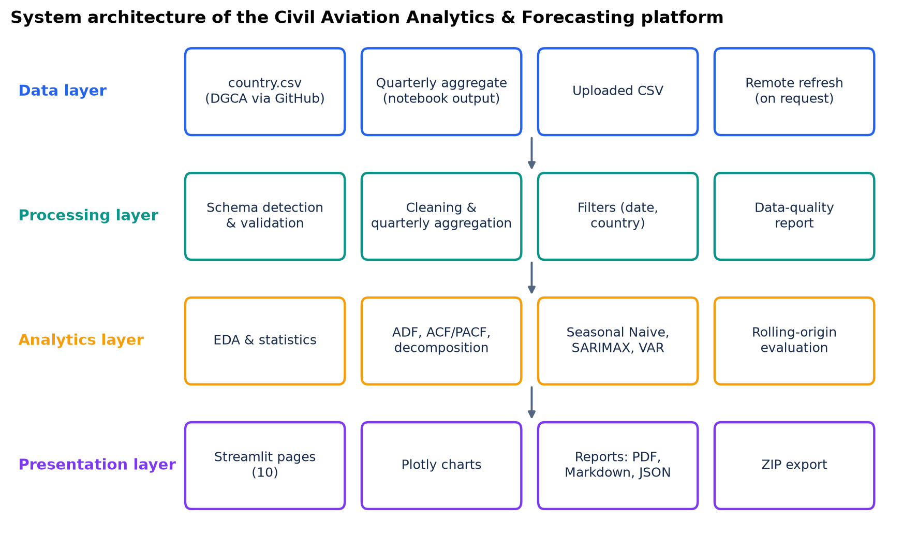

<div align="center"><b>Figure 1:</b> System architecture of the analytics and forecasting platform<br><i>(file: figures/Figure_01_System_Architecture.png)</i></div>

The analytics layer does not depend on Streamlit. Every statistical function takes ordinary pandas objects and returns ordinary results, so the same functions are used by the dashboard, by the automated tests, and by the script that generated the figures in this thesis (`thesis/generate_figures.py`). This separation guarantees that the numbers in the thesis, in the dashboard and in the downloadable reports are identical.

Table 6 summarises the modules of the analytics package.

<div align="center"><b>Table 6:</b> Modules of the analytics package</div>

| Module | Responsibility |
|---|---|
| `config/settings.py` | Paths (overridable by environment variables), schema, labels, colours, model defaults |
| `src/data_loader.py` | Reading local, uploaded and remote CSV files; month-coverage check for the latest quarter |
| `src/validation.py` | Layout detection, year/quarter validation, numeric checks, country-variant detection, latest-quarter assessment |
| `src/preprocessing.py` | Cleaning pipeline, quarterly aggregation, filtering, readiness checks for modelling |
| `src/eda.py` | Descriptive statistics, growth tables, annual totals, seasonal profiles, correlations, decomposition, automatic insights |
| `src/diagnostics.py` | ADF tests, transformations, ACF/PACF, Ljung–Box, residual summaries, Q-Q points |
| `src/forecasting.py` | Seasonal Naive, SARIMAX, VAR, exogenous projection, forecast validation |
| `src/evaluation.py` | MAE, RMSE, MAPE, sMAPE, bias; rolling-origin evaluation; SARIMAX order screening |
| `src/visualization.py` | Shared Plotly theme and chart builders (every chart requires an explicit title) |
| `src/reporting.py` | Markdown, JSON and PDF reports; static charts; ZIP packaging |
| `src/state.py`, `src/shell.py`, `src/ui.py` | Session state, cached computations, navigation, sidebar and page components |
| `src/artifacts.py` | Read-only catalogue of the notebook's saved outputs |

## 3.4 PROJECT STRUCTURE

The project folder is organised as follows. The original notebook, the source data and the notebook outputs were preserved. New work was added alongside them.

```text
india-aviation-traffic-main/
├── app.py                       # entry point: streamlit run app.py
├── requirements.txt             # dependencies with tested versions
├── README.md                    # installation and usage guide
├── .streamlit/config.toml       # light theme with navy sidebar
├── config/settings.py           # central configuration
├── src/                         # analytics package (Table 6)
├── app_pages/                   # ten dashboard pages
├── tests/                       # 73 automated tests
├── aggregated/international/    # source data (country.csv, carrier.csv)
├── notebooks/civil_aviation_forecasting.ipynb
├── outputs/                     # results saved by the notebook
│   └── dashboard_exports/       # results written by the dashboard
└── thesis/                      # this thesis, figures and generator script
```

## 3.5 CONFIGURATION AND DEPLOYMENT

All file locations are resolved relative to the project folder, so the application runs unchanged on any machine. Three environment variables allow the locations to be changed without editing code: `AVIATION_PROJECT_DIR`, `AVIATION_DATA_DIR` and `AVIATION_OUTPUT_DIR`. The notebook's original data paths, which pointed to drive `E:`, were updated to the project's location on drive `D:`, and a backup of the original notebook was kept.

The application is installed and launched with:

```bat
python -m pip install -r requirements.txt
python -m streamlit run app.py
```

The dashboard then opens at `http://localhost:8501`. Because it is a standard Streamlit application with a `requirements.txt`, it can also be deployed to Streamlit Community Cloud or any server that runs Python. Uploaded files are processed in memory as data only and are never executed. The source repository is contacted only when the user explicitly requests a refresh, and a failed download keeps the last good dataset in use.

<div style="page-break-after: always;"></div>
<div align="center" markdown="1">

# CHAPTER 4

# DESIGN APPROACH AND DETAILS

</div>

## 4.1 MATERIALS, APPROACH AND METHODS

The project follows the nine-step workflow shown in Figure 2. Steps 1–3 prepare a trustworthy quarterly dataset; steps 4–5 characterise its statistical properties; steps 6–8 build, evaluate and apply forecasting models; and step 9 diagnoses the models and reports the results. Each step is implemented as a separate, tested function, and the dashboard executes the same steps interactively.

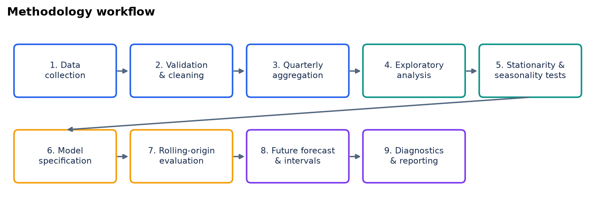

<div align="center"><b>Figure 2:</b> Methodology workflow followed in the project<br><i>(file: figures/Figure_02_Methodology_Workflow.png)</i></div>

### 4.1.1 Data collection

The country-level file is read from the local project folder by default. Three alternative sources are supported: the quarterly aggregate saved by the notebook (which carries no country detail), a CSV uploaded by the user, and a fresh download of the source file from the repository, which happens only on request. The data are read strictly as data; uploaded files are limited to 20 MB and are never executed. The loader recognises three layouts by their columns:

- **country-level**: `Year, Quarter, Country` plus the four traffic columns;
- **quarterly**: `Year, Quarter` plus the four traffic columns;
- **aggregated**: `Date` plus the four traffic columns.

Column names are matched case-insensitively and ignoring surrounding spaces. A file lacking any traffic column or any date information is rejected with a message that lists the accepted layouts, and the previously loaded dataset stays in use.

### 4.1.2 Data validation and cleaning

Validation follows one principle: **no record is changed or removed silently**. Every check writes a row to a data-quality report giving the check, its status (Pass, Info, Warning or Fail), the number of rows affected and the action taken. Records that are excluded are kept in a separate table, together with their original row number and the reason for exclusion. The checks are:

1. **Year conversion.** Integer years 0–99 are interpreted as 2000–2099, because the source stores 2015 as `15`. Four-digit years from 1900 to 2100 are kept as they are; any other value is invalid.
2. **Quarter validation.** Quarters must be whole numbers from 1 to 4 (labels such as `Q2` are accepted).
3. **Date construction.** Each record receives the first day of its quarter as its date, for example 2026 Q2 → 2026-04-01. Dates in an uploaded aggregated file are aligned to their quarter start, and the alignment is reported.
4. **Numeric conversion.** Traffic values are converted to numbers, with thousands separators removed. Entries that are present but not numeric are counted and treated as missing.
5. **Missing values** are counted per variable. Quarterly sums use the values that are available, and the report says so.
6. **Negative values** are impossible for traffic counts, so records containing them are excluded and listed.
7. **Country-name variants.** Names that differ only in letter case, spacing or a trailing asterisk are compared. If the variants never report the same quarter, they are merged under one cleaned name; if they overlap, they are kept apart and a warning is issued.
8. **Duplicates.** Exact duplicate records and records that repeat a quarter–country key with different values are detected. Only the first occurrence is kept, so that no traffic is counted twice.
9. **Quarter coverage.** After aggregation the series is re-indexed to a complete quarterly range, so any missing quarter appears as an explicit gap and is reported.
10. **Latest-quarter completeness** is assessed with the four pieces of evidence described in Section 2.3.5.

Table 7 shows the outcome of these checks for the project dataset. The source file is clean. The only interventions were the documented conversion of two-digit years and the harmonisation of the 11 records labelled "UNITED ARAB EMIRATES*". Without that harmonisation a country filter for the UAE would have returned an incomplete series of 35 quarters instead of 46.

<div align="center"><b>Table 7:</b> Data-quality checks and their outcome</div>

| Check | Status | Details | Rows affected | Action |
|---|---|---|---|---|
| Schema | Pass | Country-level layout recognised | 2,544 | Columns recognised |
| Two-digit years | Info | Years 0–99 read as 2000–2099 | 2,544 | Converted to four digits |
| Year values | Pass | 0 invalid years | 0 | None |
| Quarter values | Pass | 0 values outside 1–4 | 0 | None |
| Numeric values | Pass | All traffic values numeric | 0 | None |
| Missing values | Pass | No missing traffic values | 0 | None |
| Negative values | Pass | No negative traffic values | 0 | None |
| Country name variants | Info | 'UNITED ARAB EMIRATES*' → 'UNITED ARAB EMIRATES' | 11 | Harmonised (never share a quarter) |
| Duplicate rows | Pass | 0 exact duplicates | 0 | None |
| Duplicate quarter–country keys | Pass | 0 conflicting duplicates | 0 | None |
| Quarter coverage | Pass | 46 consecutive quarters, no gaps | 0 | None |
| Latest quarter | Pass | 2026 Q2 complete (calendar, monthly coverage, 60 countries, 92% of prior year) | 0 | None |

### 4.1.3 Quarterly aggregation

The national series are obtained by summing the cleaned records once per quarter:

$$Y_{v,t} = \sum_{c \in C_t} y_{v,c,t}, \qquad v \in \{\text{PaxToIndia}, \text{PaxFromIndia}, \text{FreightToIndia}, \text{FreightFromIndia}\},$$

where $y_{v,c,t}$ is the value of variable $v$ for country $c$ in quarter $t$, and $C_t$ is the set of countries (all countries, or the user's selection) reporting in quarter $t$. When the user selects a subset of countries, the selection is applied to the records **before** this single aggregation step. This design guarantees that country-level values are never added twice. The result is a data frame indexed by quarter-start dates with an explicit quarterly frequency (`QS-JAN`), as required by the time-series models.

### 4.1.4 Exploratory data analysis

The exploratory analysis computes the following quantities:

- **Trends**: line charts of each series, with a 4-quarter moving average $\bar{Y}_t = \tfrac{1}{4}\sum_{j=0}^{3} Y_{t-j}$ to smooth out seasonality.
- **Growth rates**: quarter-over-quarter change $100\,(Y_t - Y_{t-1})/|Y_{t-1}|$ and year-over-year change $100\,(Y_t - Y_{t-4})/|Y_{t-4}|$. A growth rate is undefined when the denominator is zero, and growth measured from a quarter below one quarter of the series median is flagged as a *small-base* rate, because such rates (for example +360% in 2022 Q2) describe the depth of the previous trough rather than unusual demand.
- **Annual totals**, with years that have fewer than four observed quarters marked as partial.
- **Seasonal profiles**: values grouped by quarter of the year, shown as grouped bars and box plots.
- **Descriptive statistics**: count, mean, median, standard deviation, minimum, quartiles, maximum, skewness, excess kurtosis and coefficient of variation.
- **Correlation**: Pearson and Spearman correlation matrices of the four series, computed both on levels and on quarter-over-quarter log changes $\Delta \log Y_t$. The latter removes the shared trend, which otherwise inflates correlations between trending series.
- **Country composition**: total traffic and share by country, and the quarterly shares of the largest origin countries.

Automatic insight statements (highest and lowest quarter, largest decline and recovery, latest year-over-year change, peak quarter of the year) are generated from these quantities. They describe patterns only and make no causal claims.

### 4.1.5 Stationarity testing

The Augmented Dickey–Fuller (ADF) test [3, 4] estimates the regression

$$\Delta Y_t = \alpha + \gamma\, Y_{t-1} + \sum_{i=1}^{k} \delta_i\, \Delta Y_{t-i} + \varepsilon_t$$

and tests $H_0: \gamma = 0$ (a unit root, so the series is non-stationary) against $H_1: \gamma < 0$ (the series is stationary). The number of lagged differences $k$ is chosen by AIC. The test is applied to each series in levels, in first differences, in seasonal differences ($Y_t - Y_{t-4}$) and in log first differences. It is run with a constant and, as a robustness check, with a constant and linear trend. Results are interpreted at the 5% significance level. Failing to reject $H_0$ is treated as evidence of non-stationarity rather than as proof of it, because the test has low power in samples of this size.

### 4.1.6 Seasonal decomposition and autocorrelation

Classical additive decomposition writes the series as

$$Y_t = T_t + S_t + R_t,$$

where the trend $T_t$ is a centred 2×4 moving average, the seasonal component $S_t$ is the average de-trended value for each quarter of the year (constrained to sum to zero), and $R_t$ is the remainder. The strengths of trend and seasonality are measured following Wang, Smith and Hyndman [31]:

$$F_T = \max\!\left(0,\; 1 - \frac{\operatorname{Var}(R_t)}{\operatorname{Var}(T_t + R_t)}\right), \qquad F_S = \max\!\left(0,\; 1 - \frac{\operatorname{Var}(R_t)}{\operatorname{Var}(S_t + R_t)}\right).$$

Values close to 1 indicate a dominant component. The autocorrelation function (ACF) and partial autocorrelation function (PACF) are computed up to lag 12 (three years) for levels and first differences. Values outside the approximate 95% band $\pm 1.96/\sqrt{n}$ are treated as significant.

### 4.1.7 Seasonal Naive benchmark

The Seasonal Naive method forecasts each future quarter with the most recent observation from the same quarter of the year:

$$\hat{Y}_{T+h} = Y_{T + h - m\lceil h/m \rceil}, \qquad m = 4.$$

It estimates no parameters, so it cannot overfit, and it already captures both seasonality and the current level. A useful model must beat it. Prediction intervals use the root mean squared seasonal difference $\hat\sigma = \sqrt{\operatorname{mean}\left[(Y_t - Y_{t-4})^2\right]}$, widened with the number of complete seasons ahead $k = \lfloor (h-1)/m \rfloor + 1$:

$$\hat{Y}_{T+h} \pm z_{1-\alpha/2}\, \hat\sigma \sqrt{k}.$$

### 4.1.8 SARIMAX

The seasonal ARIMA model with exogenous regressors, SARIMAX$(p,d,q)(P,D,Q)_s$, is estimated as a regression with SARIMA errors [1, 2]:

$$Y_t = \boldsymbol\beta^{\top}\mathbf{x}_t + u_t, \qquad \phi_p(B)\,\Phi_P(B^s)\,(1-B)^d (1-B^s)^D\, u_t = \theta_q(B)\,\Theta_Q(B^s)\, \varepsilon_t,$$

where $B$ is the backshift operator ($B Y_t = Y_{t-1}$); $\phi_p$, $\Phi_P$, $\theta_q$ and $\Theta_Q$ are the non-seasonal and seasonal autoregressive and moving-average polynomials; $s = 4$ is the seasonal period; $\mathbf{x}_t$ holds the optional exogenous regressors; and $\varepsilon_t$ is white noise with variance $\sigma^2$. Without regressors the model reduces to SARIMA. Parameters are estimated by maximum likelihood with the Kalman filter (statsmodels `SARIMAX`), without enforcing stationarity or invertibility, as in the original notebook.

The default specification, SARIMAX(1,1,1)(1,1,0,4), is taken from the project notebook. One regular difference and one seasonal difference remove the trend and the seasonal unit root that the ADF and ACF analysis suggest. One non-seasonal AR term, one MA term and one seasonal AR term then model the remaining short-run dynamics. Because the first $d + D\cdot s = 5$ in-sample residuals are dominated by the start-up effect of differencing, they are excluded from residual diagnostics. Before fitting, the code checks that the sample is long enough. It requires at least

$$n_{\min} = d + D s + \max(p + Ps,\; q + Qs,\; 1) + \max(3K,\; 2s)$$

observations, where $K$ is the number of estimated parameters; this is 22 for the default model.

An optional **log transformation** fits the model to $\log Y_t$. Forecasts and interval bounds are then transformed back with the exponential function, so the point forecast becomes a median and the bounds stay positive.

### 4.1.9 Exogenous variables: conditional and operational evaluation

The project notebook used the other three traffic series as SARIMAX regressors and evaluated the model with their **observed** values during the test period. That shows how accurate the model would be *if the future values of the regressors were known*, but at a real forecast origin they are not known. This project therefore evaluates two clearly labelled variants:

- **SARIMAX + exog (conditional)** uses the observed regressor values of the quarter being forecast. It is reported for comparison only and is excluded when choosing the model for future forecasts.
- **SARIMAX + exog (operational)** uses only information available at the forecast origin: each regressor is projected one or more quarters ahead with the Seasonal Naive method, and those projections are fed to the model. Its prediction intervals do not include the uncertainty of the projected regressors, which makes them too narrow; the dashboard states this.

### 4.1.10 Vector Autoregression

The VAR model treats the four traffic series as one vector $\mathbf{z}_t$ of stationary transformations, by default log differences $\mathbf{z}_t = \Delta \log \mathbf{Y}_t$:

$$\mathbf{z}_t = \mathbf{c} + A_1 \mathbf{z}_{t-1} + \dots + A_p \mathbf{z}_{t-p} + \mathbf{u}_t, \qquad \mathbf{u}_t \sim (\mathbf{0}, \Sigma_u),$$

with $4\times 4$ coefficient matrices $A_i$, estimated equation by equation by least squares (statsmodels `VAR`). Each equation has $Kp + 1$ coefficients for $K = 4$ variables, so the number of parameters grows quickly with the lag order. To prevent over-parameterisation on the short sample, the largest permissible lag is the largest $p$ that satisfies

$$n - p \ \ge\ 5\,(Kp + 1),$$

so that every equation has at least five observations per coefficient. With $n = 45$ transformed observations this allows only $p = 1$. The lag order is then chosen within this limit by BIC. Before fitting, the code checks the model's suitability: at least two variables, the target among them, no missing or non-finite values, strictly positive values when logarithms are used, and ADF tests on the transformed series.

Forecasts of $\mathbf{z}$ are cumulated back to log levels and exponentiated. Because a level forecast $h$ steps ahead is the sum of $h$ forecast changes, its error variance follows from the moving-average representation $\mathbf{z}_t = \sum_i \Psi_i \mathbf{u}_{t-i}$:

$$\operatorname{Var}\!\left(\log Y_{T+h} - \widehat{\log Y}_{T+h}\right) = \left[\sum_{j=0}^{h-1} C_j\, \Sigma_u\, C_j^{\top}\right]_{ii}, \qquad C_j = \sum_{l=0}^{j} \Psi_l.$$

This analytic interval reflects shock uncertainty only; parameter-estimation uncertainty is not included.

### 4.1.11 Rolling-origin evaluation

A single train/test split gives one estimate of accuracy that depends heavily on where the split falls. Following Tashman [8] and Hyndman and Athanasopoulos [2], models are instead compared by **expanding-window rolling-origin evaluation** with one-step-ahead forecasts (Figure 3):

1. Choose the evaluation period, the last $H = 12$ quarters (2023 Q3 – 2026 Q2).
2. For the first evaluation quarter, fit every model on the 34 quarters before it (2015 Q1 – 2023 Q2) and forecast that quarter.
3. Record the error *actual − predicted*.
4. Add the evaluated quarter to the training window and repeat until the last quarter.

Every model is evaluated on exactly the same quarters. A programmatic guard asserts at each origin that the last training date precedes the forecast date, so test data can never enter the training window. If a model fails to fit at an origin, the failure is recorded, and metrics are computed only on quarters where every model produced a forecast.

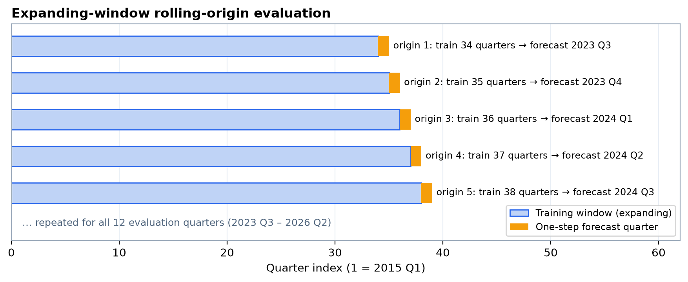

<div align="center"><b>Figure 3:</b> Expanding-window rolling-origin evaluation scheme<br><i>(file: figures/Figure_03_Rolling_Origin_Scheme.png)</i></div>

### 4.1.12 Error metrics

With $e_t = Y_t - \hat Y_t$ over the $n$ evaluation quarters:

$$\text{MAE} = \frac{1}{n}\sum |e_t|, \qquad \text{RMSE} = \sqrt{\frac{1}{n}\sum e_t^2}, \qquad \text{MAPE} = \frac{100}{n'}\sum_{Y_t \ne 0} \left|\frac{e_t}{Y_t}\right|,$$

$$\text{sMAPE} = \frac{100}{n}\sum \frac{2\,|e_t|}{|Y_t| + |\hat Y_t|}, \qquad \text{Bias} = \frac{1}{n}\sum e_t.$$

MAE is reported in passengers and is the primary ranking metric because it is robust and easy to interpret. RMSE penalises large misses, and MAPE and sMAPE express the error relative to the traffic level. MAPE skips quarters with zero actual traffic, and the number of quarters used ($n'$) is reported alongside it. A positive bias means the model under-predicts on average.

### 4.1.13 Future forecasting and validation

The model with the lowest rolling MAE, among those that can forecast without observed future values, is refitted on all 46 quarters and forecasts the next eight quarters, 2026 Q3 to 2028 Q2. The first forecast quarter is derived from the last observed quarter, never hard-coded. Each forecast is validated: horizon length, consecutive quarterly dates, no overlap with observed quarters, finite values, ordered bounds (lower ≤ forecast ≤ upper), and non-negative point forecasts and bounds. A failed check is reported rather than "fixed": negative lower bounds are kept as estimated and flagged, and the dashboard offers a clearly labelled, display-only option to truncate them at zero.

### 4.1.14 Residual diagnostics

Two quantities are diagnosed separately and never confused:

- **In-sample residuals** of a model fitted to all quarters, which show how well the model describes the data it was fitted on; and
- **rolling forecast errors** (actual − predicted), which show how well the model forecasts unseen quarters.

For each, the analysis reports the mean (with a t-test of zero mean), standard deviation, skewness and excess kurtosis; the Shapiro–Wilk [29] and Jarque–Bera [30] normality tests; the residual ACF; and the Ljung–Box statistic [5]

$$Q(m) = n(n+2)\sum_{k=1}^{m} \frac{\hat\rho_k^2}{n-k},$$

which tests the null hypothesis of no autocorrelation up to lag $m$, with degrees of freedom reduced by the number of ARMA parameters. With fewer than 20 values, a warning reminds the user that these tests have low power.

Table 8 summarises the model specifications and their default settings.

<div align="center"><b>Table 8:</b> Model specifications and default parameters</div>

| Model | Specification | Estimation | Prediction interval | Key settings |
|---|---|---|---|---|
| Seasonal Naive | $\hat Y_{T+h} = Y_{T+h-4\lceil h/4\rceil}$ | None | Normal, $\hat\sigma\sqrt{k}$ | Period 4 |
| SARIMAX | SARIMA(1,1,1)(1,1,0,4) | Maximum likelihood (Kalman filter) | Model-based | Optional log scale |
| SARIMAX + exog (conditional) | As above + 3 regressors (observed future values) | Maximum likelihood | Not used for future forecasts | Evaluation only |
| SARIMAX + exog (operational) | As above + 3 regressors (Seasonal Naive projections) | Maximum likelihood | Model-based (excludes regressor uncertainty) | Regressors projected at origin |
| VAR | VAR(p) on $\Delta\log$ of 4 series | Least squares; lag by BIC | Analytic, cumulated MA representation | $p \le$ sample-size cap (= 1) |

## 4.2 CODES AND STANDARDS

### 4.2.1 Coding standards

The software was written to the following standards:

- **Modularity.** The analytics functions (`src/`) are independent of the user interface. Each function has one responsibility and takes and returns plain pandas or NumPy objects.
- **Style.** Code follows PEP 8 naming and layout, with type hints and docstrings on public functions.
- **Configuration.** Paths, column names, colours and model defaults live in `config/settings.py`; no Windows-specific absolute path is hard-coded in the application.
- **Error handling.** Invalid inputs raise descriptive exceptions (`SchemaError`, `DataLoadError`, `ForecastError`) that the interface shows as readable messages; failures are also logged. A failure in one model never stops the evaluation of the others.
- **Transparency.** No data are changed silently, every transformation is reported, and intervals are never presented as guarantees.
- **Reproducibility.** Every figure and number in the dashboard, the reports and this thesis is computed by the same functions from the source data. Results are cached by the exact data and parameters used, so changing a parameter always triggers a fresh fit.
- **Security.** Uploaded files are parsed as data only, sizes are limited, no secrets or API keys are required, and the network is used only on explicit request.

### 4.2.2 Data loading and aggregation

The following function performs the single, gap-preserving quarterly aggregation described in Section 4.1.3.

```python
def aggregate_quarterly(records: pd.DataFrame, columns: list[str] | None = None) -> pd.DataFrame:
    """Sum records per quarter exactly once and reindex to a regular quarterly range.

    Quarters without any record appear as rows of NaN so gaps stay visible.
    """
    columns = columns or TRAFFIC_COLUMNS
    if records.empty:
        return pd.DataFrame(columns=columns, index=pd.DatetimeIndex([], name="Date", freq="QS-JAN"))
    grouped = records.groupby("Date")[columns].sum(min_count=1).sort_index()
    full = pd.date_range(grouped.index.min(), grouped.index.max(), freq="QS-JAN", name="Date")
    return grouped.reindex(full)
```

### 4.2.3 Seasonal Naive benchmark

```python
def seasonal_naive_forecast(series, horizon, period=4, ci_level=95):
    horizon = check_horizon(horizon)
    s = check_series(series)
    if len(s) < period + 2:
        raise ForecastError(f"Seasonal Naive needs at least {period + 2} observations; found {len(s)}.")
    idx = future_index(s.index[-1], horizon)
    values = np.array([s.iloc[len(s) - period + ((h - 1) % period)] for h in range(1, horizon + 1)])
    resid = (s - s.shift(period)).dropna()
    sigma = float(np.sqrt(np.mean(resid ** 2)))
    k = np.array([(h - 1) // period + 1 for h in range(1, horizon + 1)])
    half = z_value(ci_level) * sigma * np.sqrt(k)
    fc = pd.DataFrame({"Forecast": values, "Lower": values - half, "Upper": values + half}, index=idx)
```

### 4.2.4 SARIMAX estimation and forecasting

The listing below is a simplified excerpt of `sarimax_forecast` in `src/forecasting.py`; input validation and residual handling are omitted.

```python
model = SARIMAX(y, exog=exog, order=cfg.order, seasonal_order=cfg.seasonal_order,
                enforce_stationarity=False, enforce_invertibility=False)
res = model.fit(disp=False, maxiter=200)
pred = res.get_forecast(steps=horizon, exog=exog_future)
mean = np.asarray(pred.predicted_mean)
ci = np.asarray(pred.conf_int(alpha=1 - ci_level / 100))
fc = pd.DataFrame({"Forecast": mean, "Lower": ci[:, 0], "Upper": ci[:, 1]}, index=future_index(...))
if cfg.log:                          # model fitted to log values
    fc = np.exp(fc)
converged = bool(res.mle_retvals.get("converged", True))
```

### 4.2.5 Operational projection of exogenous regressors

```python
def project_exog(exog: pd.DataFrame, horizon: int, period: int = 4) -> pd.DataFrame:
    """Operational exogenous inputs: each regressor projected by Seasonal Naive using only
    data available at the forecast origin."""
    idx = future_index(exog.index[-1], horizon)
    return pd.DataFrame(
        {c: [exog[c].iloc[len(exog) - period + ((h - 1) % period)] for h in range(1, horizon + 1)]
         for c in exog.columns}, index=idx)
```

### 4.2.6 VAR lag limit and level prediction intervals

The second part of the listing is a simplified excerpt of `var_forecast` for the log-difference transformation.

```python
def var_lag_cap(n_transformed: int, k: int, max_lag: int, seasonal_dummies: bool) -> int:
    """Largest lag order with at least five observations per estimated coefficient in each equation."""
    extra = 3 if seasonal_dummies else 0
    best = 0
    for p in range(1, max_lag + 1):
        if n_transformed - p >= OBS_PER_COEF * (k * p + 1 + extra):
            best = p
    return best

# Forecast changes, then cumulate to log levels with an analytic interval
mean_z = res.forecast(z.to_numpy()[-lag:], steps=horizon)
psi = res.ma_rep(maxn=horizon - 1)               # MA coefficient matrices Psi_0 ... Psi_{h-1}
cum = np.cumsum(psi, axis=0)                     # C_j = Psi_0 + ... + Psi_j
var_level = np.cumsum([(c @ sigma_u @ c.T)[i, i] for c in cum])
centre = np.log(data[target].iloc[-1]) + np.cumsum(mean_z[:, i])
half = z_value(ci_level) * np.sqrt(var_level)
fc = np.exp(pd.DataFrame({"Forecast": centre, "Lower": centre - half, "Upper": centre + half}, index=idx))
```

### 4.2.7 Leakage-free rolling-origin loop

```python
for i in range(start, n):
    date = data.index[i]
    train = data.iloc[:i]
    # Leakage guard: training data must end strictly before the forecast quarter.
    assert train.index.max() < date, "training window overlaps the evaluation quarter"
    row = {"Date": date, "Train end": train.index.max(), "Train size": len(train),
           "Actual": float(data[target].iloc[i])}
    for m in models:
        try:
            row[m] = _one_step(m, train, data.iloc[[i]], target, period, sarimax_cfg, var_cfg)
        except (fc.ForecastError, ValueError, np.linalg.LinAlgError) as exc:
            row[m] = np.nan
            failures.append({"Date": quarter_label(date), "Model": m, "Error": str(exc)})
    rows.append(row)
```

### 4.2.8 Zero-safe percentage error

```python
def mape(actual, predicted) -> tuple[float, int]:
    """Mean absolute percentage error over non-zero actuals. Returns (value, n_used)."""
    a, p = _arrays(actual, predicted)
    nonzero = a != 0
    if not nonzero.any():
        return float("nan"), 0
    return float(np.mean(np.abs((a[nonzero] - p[nonzero]) / a[nonzero])) * 100), int(nonzero.sum())
```

### 4.2.9 Testing standards

Correctness was verified with 73 automated tests written with pytest and Streamlit's `AppTest` framework (Table 9). The tests cover the data rules, the mathematics of the metrics and models, the absence of look-ahead bias, and the behaviour of the whole application. Two of them are regression tests that compare the new code with results saved by the original notebook: the rolling-origin MAE of SARIMAX, VAR and Seasonal Naive, and the SARIMAX eight-quarter forecast. All 73 tests pass.

<div align="center"><b>Table 9:</b> Automated test suite summary</div>

| Test file | Tests | What is verified |
|---|---|---|
| `test_data_validation.py` | 15 | Required columns, case-insensitive names, two-digit years, invalid quarters, chronological quarter-start dates, exact and conflicting duplicates, missing and non-numeric values, negative values, missing quarters, latest-quarter completeness, upload limits, country-variant harmonisation |
| `test_preprocessing.py` | 8 | Aggregation sums every record exactly once; country filters applied before aggregation; date windows; aggregated layout; mid-quarter date alignment; readiness checks; reproduction of the notebook's quarterly file |
| `test_forecasting.py` | 17 | Invalid horizons rejected; for every model: correct number of rows, future consecutive dates, finite values, ordered bounds; Seasonal Naive values; clear errors for non-numeric, missing or short series; positive log-model bounds; conditional model refused for future forecasts; VAR suitability; reproduction of the notebook forecast |
| `test_evaluation.py` | 9 | MAE, RMSE, MAPE (zero actuals), sMAPE and bias against hand calculations; identical evaluation dates for all models; training window always ends before the forecast quarter; conditional ≠ operational; insufficient-window errors; best-model selection; reproduction of the notebook's rolling metrics |
| `test_app.py` | 24 | Every page renders without exceptions through the real application shell; dashboard KPIs and charts; each Forecasting Laboratory model; country filter; data-source switching and reload; report package (PDF, Markdown with all 16 sections, ZIP contents); forecast PDF; missing output folder handled; plain artifact names |
| **Total** | **73** | **All passed** |

<div style="page-break-after: always;"></div>
<div align="center" markdown="1">

# CHAPTER 5

# SCHEDULE, TASKS AND MILESTONES

</div>

The project was carried out over one semester, from 6 July 2026 to 30 October 2026, followed by the final review in November 2026. The work was planned in weekly blocks. Several activities overlapped deliberately: dashboard development began while the models were still being evaluated, so that every analytical function could be exposed in the interface as soon as it had been tested. Table 10 lists the tasks and milestones, and Figure 4 shows the same plan as a Gantt chart.

<div align="center"><b>Table 10:</b> Schedule, tasks and milestones</div>

| S. No. | Month – Week | Task | Milestone / Deliverable |
|---|---|---|---|
| 1 | July – Week 1, 2 | Identification of the problem; literature review on air-traffic forecasting, SARIMAX, VAR and forecast evaluation | Problem statement and research questions agreed with the guide |
| 2 | July – Week 3, 4 | Data collection from the *india-aviation-traffic* repository; validation rules; quarterly aggregation | Validated quarterly dataset and data-quality report |
| 3 | July – Week 4 to August – Week 1 | Exploratory data analysis: trends, growth, seasonality, correlation, country composition | EDA figures and descriptive statistics |
| 4 | August – Week 1, 2 | Stationarity tests (ADF), ACF/PACF, seasonal decomposition | Choice of differencing and seasonal period |
| 5 | August – Week 2 to September – Week 1 | Development of Seasonal Naive, SARIMAX (with and without exogenous variables) and VAR models | Working, validated model functions |
| 6 | August – Week 4 to September – Week 1 | Expanding-window rolling-origin evaluation; SARIMAX order screening | Model comparison table; selected model |
| 7 | August – Week 4 to September – Week 4 | Streamlit dashboard: ten pages, shared chart theme, reports and downloads | Interactive application |
| 8 | September – Week 4 to October – Week 1 | Automated testing (73 tests), browser verification, bug fixing | All tests passing |
| 9 | October – Week 1 to Week 4 | Eight-quarter forecast, residual diagnostics, thesis writing and figure generation | Draft thesis |
| 10 | October – Week 4 | Feedback from guide and revisions | Revised thesis |
| 11 | November – Week 1 | Final review | Final submission and demonstration |

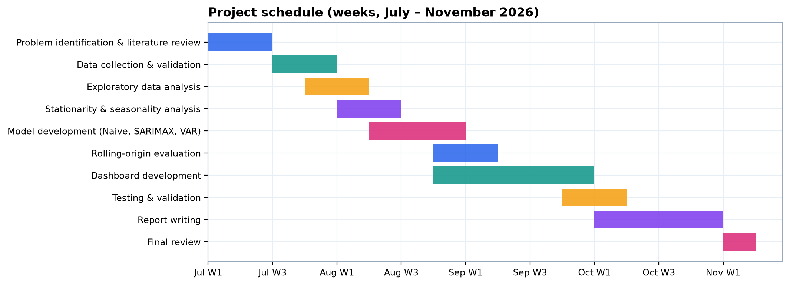

<div align="center"><b>Figure 4:</b> Project schedule as a Gantt chart<br><i>(file: figures/Figure_04_Project_Schedule_Gantt.png)</i></div>

All milestones were met. The main deviation from the original plan was that model evaluation took longer than expected, for two reasons. First, the notebook's original evaluation used observed future values of the explanatory variables, so a separate operational variant had to be designed (Section 4.1.9). Second, the VAR model needed a sample-size rule to avoid over-parameterisation (Section 4.1.10). The overlap between model development and dashboard development absorbed this delay.

<div style="page-break-after: always;"></div>
<div align="center" markdown="1">

# CHAPTER 6

# PROJECT OUTPUTS

</div>

This chapter presents the outputs produced by the project: the figures generated by the analysis (Sections 6.1–6.7) and the interactive dashboard (Section 6.8). Every figure was produced from the validated dataset by `thesis/generate_figures.py`, which calls the same functions as the dashboard, and each is stored in the `thesis/figures/` folder under the file name given below its caption. The interpretation of these outputs is discussed in Chapter 7.

## 6.1 TRAFFIC TRENDS AND GROWTH

### 6.1.1 Quarterly passenger traffic to and from India

Figure 5 shows the two passenger series over the 46 quarters. Arrivals and departures move almost in lock-step. Both rise steadily from about 5.7–6.4 million per quarter in 2015 to roughly 8 million in 2019, collapse in 2020 (the shaded COVID-19 period), recover through 2021–2023, and reach new highs after 2024. Arrivals peaked at 10,752,640 in 2025 Q4 and were lowest at 294,246 in 2020 Q2.

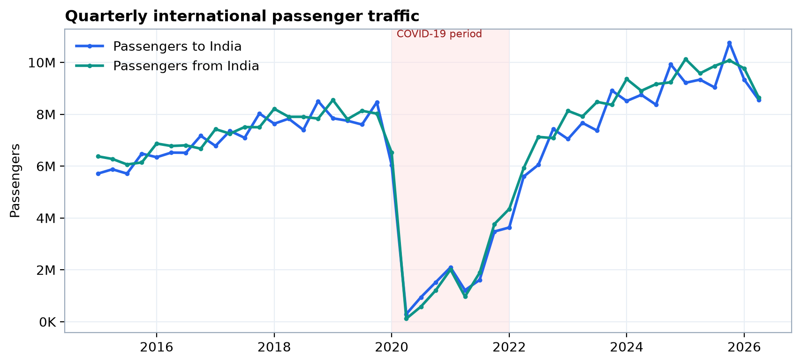

<div align="center"><b>Figure 5:</b> Quarterly passenger traffic to and from India, 2015 Q1 – 2026 Q2<br><i>(file: figures/Figure_05_Passenger_Traffic_Trends.png)</i></div>

### 6.1.2 Quarterly freight traffic to and from India

Figure 6 shows freight traffic. Outbound freight is consistently larger than inbound freight. Freight also fell in 2020, but far less than passenger traffic, and it recovered faster. Both freight series reached their highest values in 2026 Q1 (243,002 inbound and 324,925 outbound, in source units).

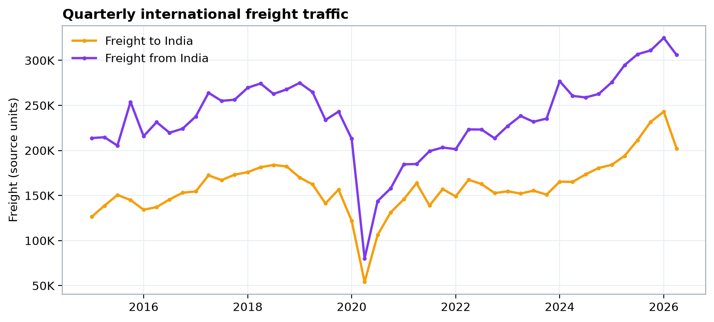

<div align="center"><b>Figure 6:</b> Quarterly freight traffic to and from India, 2015 Q1 – 2026 Q2<br><i>(file: figures/Figure_06_Freight_Traffic_Trends.png)</i></div>

### 6.1.3 Moving average of passengers to India

Figure 7 overlays a four-quarter moving average on the arrivals series. Because each window spans one full year, the average removes the seasonal pattern and shows the underlying level. The level regains its 2019 value by early 2024 and keeps rising through 2025.

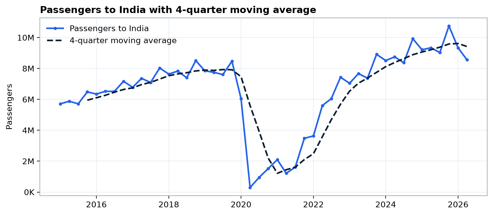

<div align="center"><b>Figure 7:</b> Passengers to India with a four-quarter moving average<br><i>(file: figures/Figure_07_PaxToIndia_Moving_Average.png)</i></div>

### 6.1.4 Quarter-over-quarter growth

Figure 8 shows the percentage change from one quarter to the next. Before 2020 the changes are small and alternate with the seasons. The largest decline is −95.1% in 2020 Q2, and the largest increase is +220.9% in 2020 Q3. That increase is measured from the very small 2020 Q2 base, so it is highlighted in amber: it reflects the depth of the trough rather than strong demand.

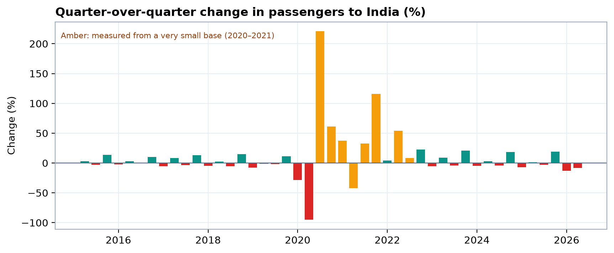

<div align="center"><b>Figure 8:</b> Quarter-over-quarter change in passengers to India<br><i>(file: figures/Figure_08_PaxToIndia_QoQ_Growth.png)</i></div>

### 6.1.5 Year-over-year growth

Figure 9 compares each quarter with the same quarter a year earlier, which removes seasonality from the comparison. The deepest fall is −96.2% in 2020 Q2. The apparent growth of +360.8% in 2022 Q2 again comes from a tiny base. The most recent quarter, 2026 Q2, is 8.3% below 2025 Q2.

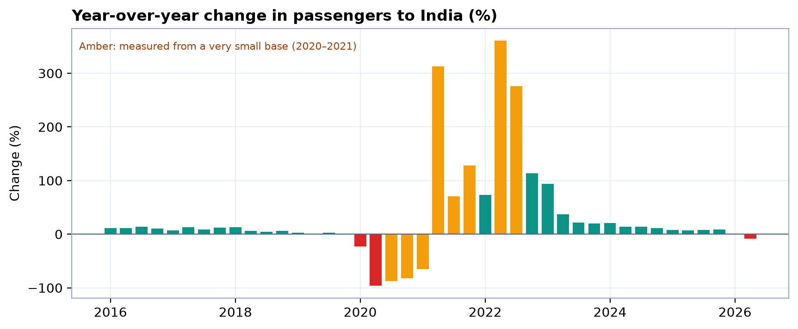

<div align="center"><b>Figure 9:</b> Year-over-year change in passengers to India<br><i>(file: figures/Figure_09_PaxToIndia_YoY_Growth.png)</i></div>

### 6.1.6 Annual totals

Figures 10 and 11 aggregate the quarters into calendar years. Annual arrivals grew from 23.78 million in 2015 to 31.66 million in 2019, fell to 8.80 million in 2020 and 8.40 million in 2021, and recovered to 38.33 million in 2025. The year 2026 is marked as partial, since it contains only two quarters. Freight followed a similar but much shallower path.

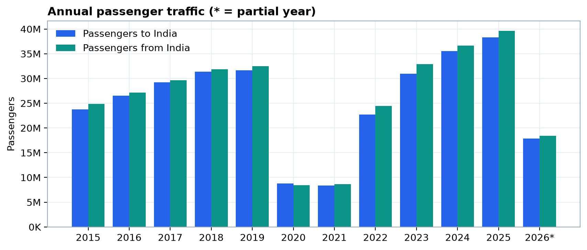

<div align="center"><b>Figure 10:</b> Annual passenger traffic totals<br><i>(file: figures/Figure_10_Annual_Passenger_Traffic.png)</i></div>

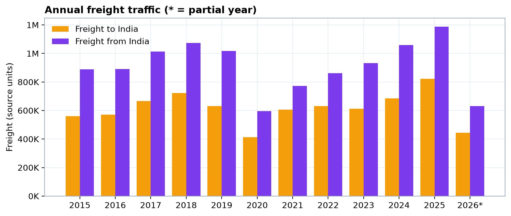

<div align="center"><b>Figure 11:</b> Annual freight traffic totals<br><i>(file: figures/Figure_11_Annual_Freight_Traffic.png)</i></div>

## 6.2 SEASONALITY AND DISTRIBUTION

### 6.2.1 Quarter-by-year comparison

Figure 12 groups arrivals by year, with one bar per quarter. In almost every normal year the fourth quarter (October–December) is the tallest bar, which is consistent with year-end holiday travel and the return of non-resident Indians. Within the bars for 2020 the effect of the pandemic stands out sharply.

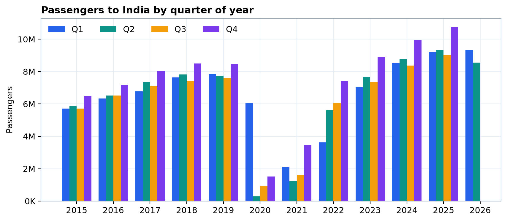

<div align="center"><b>Figure 12:</b> Passengers to India by quarter and year<br><i>(file: figures/Figure_12_Quarterly_Seasonal_Comparison.png)</i></div>

### 6.2.2 Distribution by quarter of year

Figure 13 summarises the same data as box plots per quarter of the year. Q4 has the highest median, and every quarter shows low outliers from 2020–2021. Averaged over the whole period, Q4 carries 7.33 million arrivals, against 6.15–6.68 million for the other quarters.

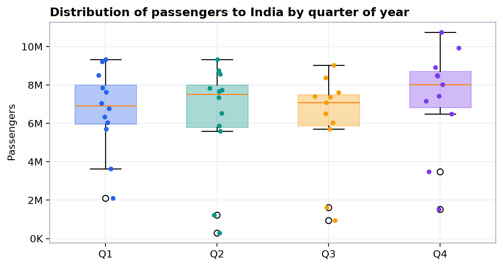

<div align="center"><b>Figure 13:</b> Distribution of passengers to India by quarter of year<br><i>(file: figures/Figure_13_Quarter_of_Year_Boxplot.png)</i></div>

### 6.2.3 Distributions of the four variables

Figure 14 shows histograms of the quarterly values. The passenger series are left-skewed: most quarters cluster between 6 and 10 million, while a small number of pandemic quarters form a long lower tail. The freight distributions are more symmetric but heavy-tailed.

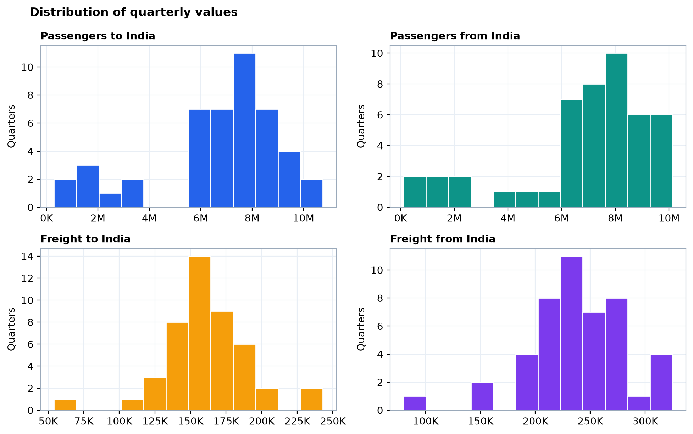

<div align="center"><b>Figure 14:</b> Histograms of the four quarterly traffic variables<br><i>(file: figures/Figure_14_Variable_Distributions.png)</i></div>

## 6.3 RELATIONSHIPS AND COUNTRY COMPOSITION

### 6.3.1 Correlation matrices

Figure 15 shows Pearson correlations between the levels of the four series. The two passenger series are almost perfectly correlated (r = 0.98), and passengers correlate with outbound freight at about 0.88. Figure 16 repeats the calculation on quarter-over-quarter log changes, which removes the shared long-run trend. The correlations stay high (0.81–0.97), so the series also move together from quarter to quarter.

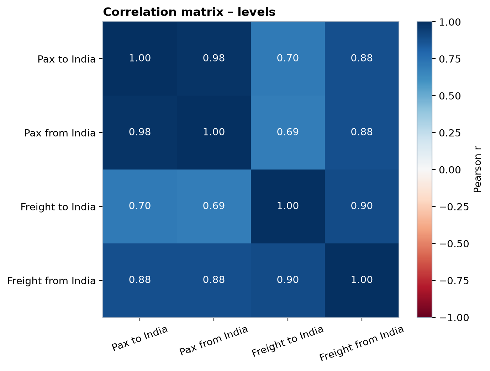

<div align="center"><b>Figure 15:</b> Pearson correlation matrix of the traffic variables (levels)<br><i>(file: figures/Figure_15_Correlation_Heatmap_Levels.png)</i></div>

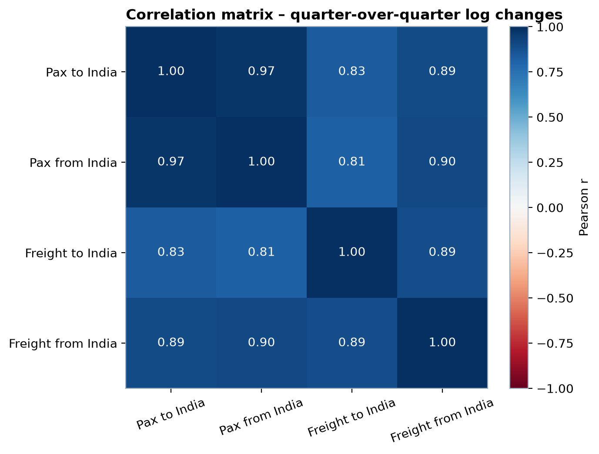

<div align="center"><b>Figure 16:</b> Pearson correlation matrix of the traffic variables (quarter-over-quarter log changes)<br><i>(file: figures/Figure_16_Correlation_Heatmap_Log_Changes.png)</i></div>

### 6.3.2 Scatter-plot matrix

Figure 17 plots every pair of variables against each other, with histograms on the diagonal. The passenger pair lies on a near-straight line. The pandemic quarters form a separate cluster in the lower-left corner of each panel, which partly drives the high correlations of the freight series with the passenger series.

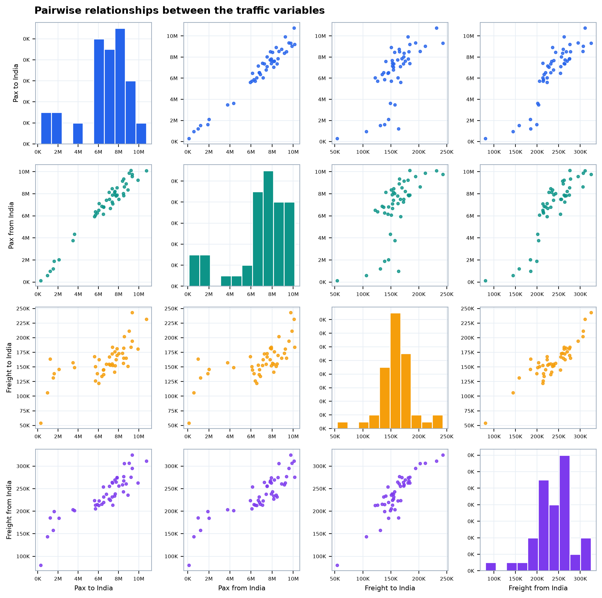

<div align="center"><b>Figure 17:</b> Scatter-plot matrix of the four quarterly traffic variables<br><i>(file: figures/Figure_17_Scatter_Matrix.png)</i></div>

### 6.3.3 Origin countries

Figure 18 ranks the 15 countries that sent the most passengers to India over the whole period, with each country's share of the total. The United Arab Emirates dominates with 31.7% of all arrivals, followed by Singapore (7.0%), Saudi Arabia (6.2%), Thailand (6.1%) and Qatar (5.9%). Together, the top five countries account for 56.9% of arrivals.

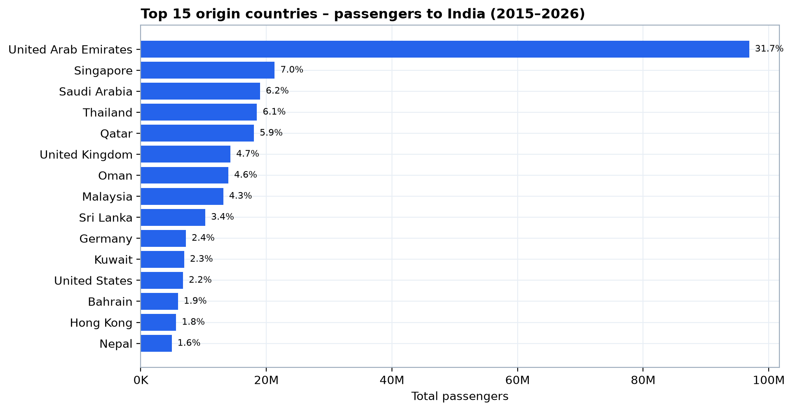

<div align="center"><b>Figure 18:</b> Top 15 countries by total passengers to India<br><i>(file: figures/Figure_18_Top_Countries.png)</i></div>

Figure 19 follows the quarterly share of these five countries. The UAE's share declined from 32.5% in 2015 Q1 to 26.9% in 2026 Q2, while Thailand's rose from 5.2% to 8.2%, indicating a gradual diversification of India's inbound markets.

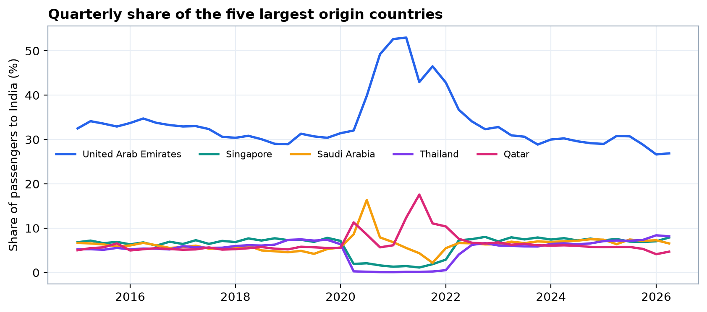

<div align="center"><b>Figure 19:</b> Quarterly share of passengers to India for the five largest origin countries<br><i>(file: figures/Figure_19_Top_Country_Shares.png)</i></div>

## 6.4 DECOMPOSITION AND TIME-SERIES DIAGNOSTICS

### 6.4.1 Seasonal decomposition

Figure 20 decomposes passenger arrivals into trend, seasonal and residual components. The trend carries almost all of the variation (trend strength 0.95), including the pandemic collapse. The seasonal component adds about +680,000 passengers in Q4 and subtracts about 430,000 in Q3. The largest residuals fall in 2020–2021, where the moving-average trend cannot follow the abrupt break.

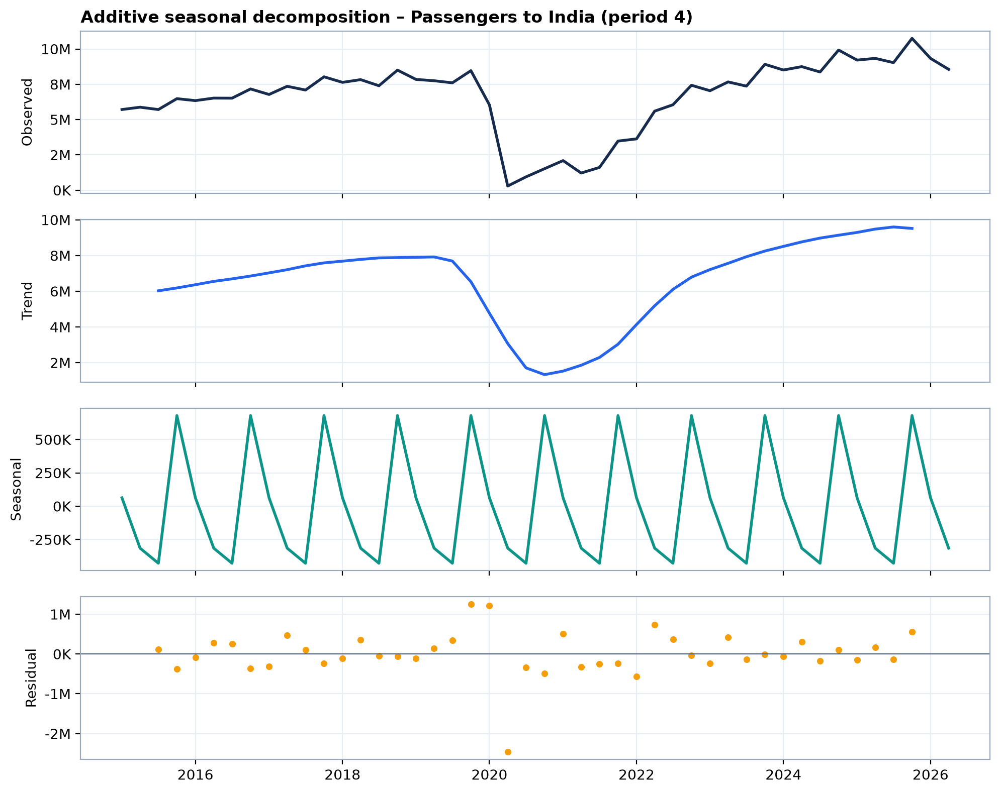

<div align="center"><b>Figure 20:</b> Additive seasonal decomposition of passengers to India<br><i>(file: figures/Figure_20_Seasonal_Decomposition_PaxToIndia.png)</i></div>

Figure 21 applies the same decomposition to inbound freight. Its seasonality is very weak (seasonal strength 0.06), so freight is driven mainly by trend and irregular movements.

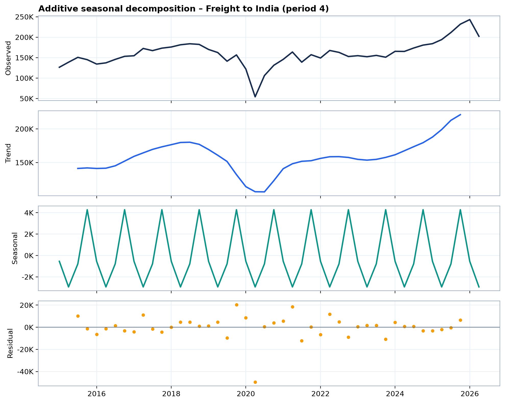

<div align="center"><b>Figure 21:</b> Additive seasonal decomposition of freight to India<br><i>(file: figures/Figure_21_Seasonal_Decomposition_FreightToIndia.png)</i></div>

### 6.4.2 Autocorrelation structure

Figure 22 shows the ACF and PACF of arrivals in levels. The ACF decays slowly from 0.88 at lag 1 and stays significant up to lag 5, the typical signature of a non-stationary, trending series. After first differencing (Figure 23), the only significant spike in either function is at lag 4 (ACF 0.33, PACF 0.34). This points to an annual seasonal dependence that a seasonal term with period 4 should capture.

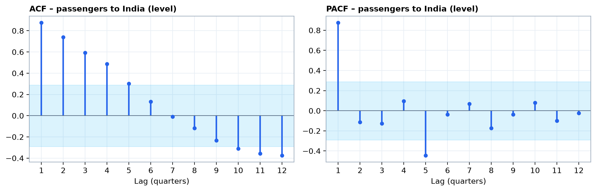

<div align="center"><b>Figure 22:</b> ACF and PACF of passengers to India (level)<br><i>(file: figures/Figure_22_ACF_PACF_Level.png)</i></div>

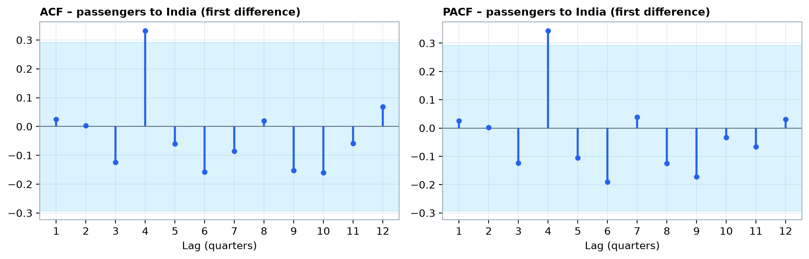

<div align="center"><b>Figure 23:</b> ACF and PACF of passengers to India (first difference)<br><i>(file: figures/Figure_23_ACF_PACF_First_difference.png)</i></div>

### 6.4.3 Seasonal sub-series

Figure 24 draws one line per quarter of the year across the years. The four lines move in parallel, sharing the trend and the pandemic break, while the Q4 line lies above the others in most years. This confirms that the seasonal pattern is stable relative to the trend.

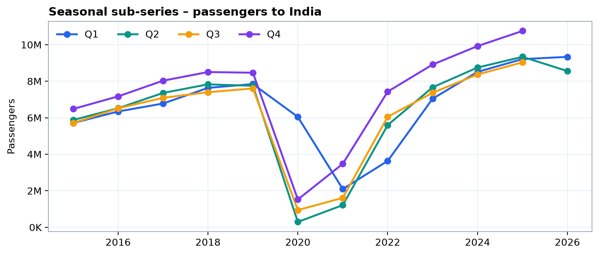

<div align="center"><b>Figure 24:</b> Seasonal sub-series plot of passengers to India<br><i>(file: figures/Figure_24_Seasonal_Subseries.png)</i></div>

## 6.5 MODEL FITTING AND EVALUATION

### 6.5.1 SARIMAX in-sample fit

Figure 25 compares arrivals with the one-step in-sample fitted values of SARIMAX(1,1,1)(1,1,0,4) estimated on all 46 quarters. The first five fitted values are omitted because of the start-up effect of differencing. The model tracks normal periods closely. Around the 2020 collapse and the 2021–2022 rebound, the fitted values lag the actual values, because a model based on past observations cannot anticipate a sudden shock.

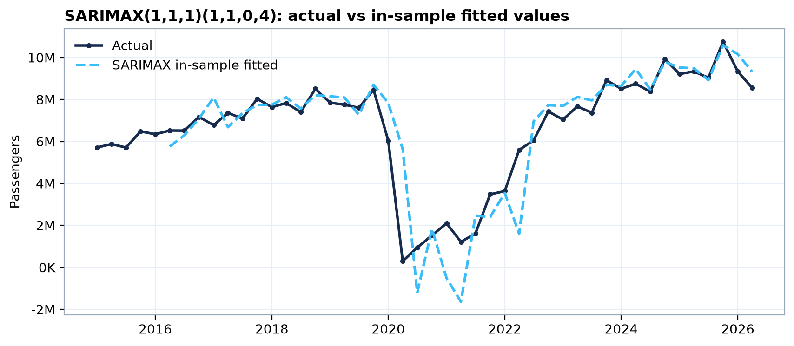

<div align="center"><b>Figure 25:</b> SARIMAX(1,1,1)(1,1,0,4) actual versus in-sample fitted values<br><i>(file: figures/Figure_25_SARIMAX_Fitted_vs_Actual.png)</i></div>

### 6.5.2 Rolling-origin forecasts

Figure 26 shows the one-step forecasts of the three main models over the 12 evaluation quarters. SARIMAX follows the actual path most closely. Seasonal Naive sits below the actual values in 11 of the 12 quarters, because it repeats last year's value during a period of growth. VAR produces several large over-forecasts in 2025–2026.

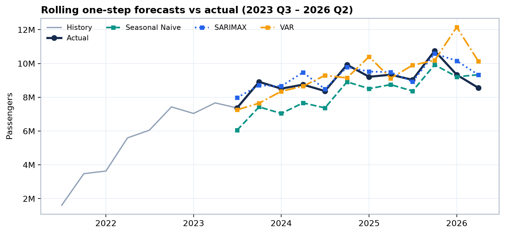

<div align="center"><b>Figure 26:</b> Rolling-origin one-step forecasts of Seasonal Naive, SARIMAX and VAR against actual values<br><i>(file: figures/Figure_26_Rolling_Actual_vs_Predicted.png)</i></div>

Figure 27 isolates the effect of the exogenous traffic variables. The conditional variant, which is given the observed future regressors, is almost indistinguishable from the actual values. The operational variant, which must project its regressors, falls below the actual values in 11 of the 12 quarters, much like the Seasonal Naive method used for the projections.

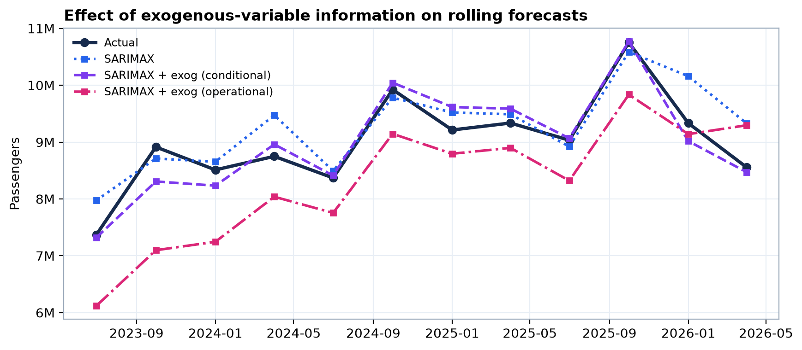

<div align="center"><b>Figure 27:</b> Conditional versus operational SARIMAX with exogenous regressors<br><i>(file: figures/Figure_27_Exogenous_Conditional_vs_Operational.png)</i></div>

### 6.5.3 Error metrics

Figure 28 compares MAE, RMSE and MAPE for the five model variants. Among the models that can be used in practice, the univariate SARIMAX has the lowest error on all three metrics. The conditional SARIMAX appears best, but only because it is given information that would not be available at forecast time.

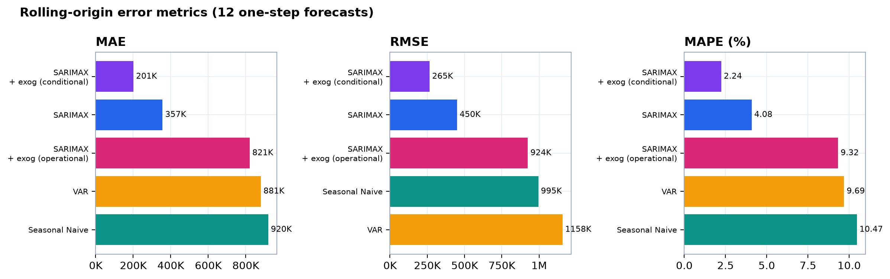

<div align="center"><b>Figure 28:</b> MAE, RMSE and MAPE of the five model variants<br><i>(file: figures/Figure_28_Model_Error_Metrics.png)</i></div>

### 6.5.4 Forecast errors by quarter and their distribution

Figure 29 shows the error of each main model in each evaluation quarter, and Figure 30 summarises the errors of all five variants as box plots. The Seasonal Naive errors are almost all positive (under-prediction). The SARIMAX errors are small and centred slightly below zero, meaning a mild tendency to over-predict. The VAR errors have the widest spread.

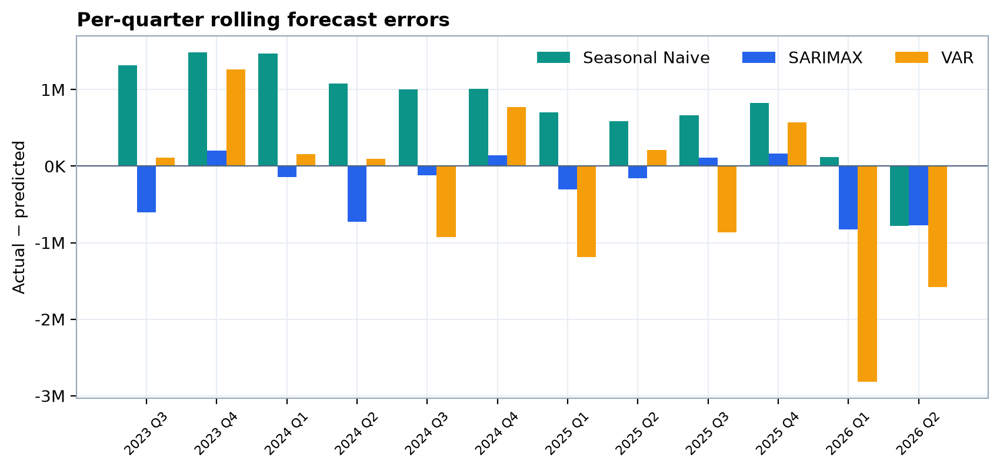

<div align="center"><b>Figure 29:</b> Per-quarter rolling forecast errors (actual − predicted)<br><i>(file: figures/Figure_29_Per_Quarter_Errors.png)</i></div>

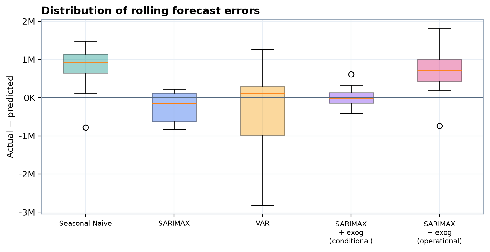

<div align="center"><b>Figure 30:</b> Distribution of rolling forecast errors by model<br><i>(file: figures/Figure_30_Error_Distribution.png)</i></div>

### 6.5.5 SARIMAX order screening

Figure 31 compares six SARIMAX orders on the same 12 rolling forecast origins. All six beat the Seasonal Naive benchmark (dashed line). The simpler models without seasonal AR or MA terms achieve the lowest MAE, around 280,000–307,000 passengers.

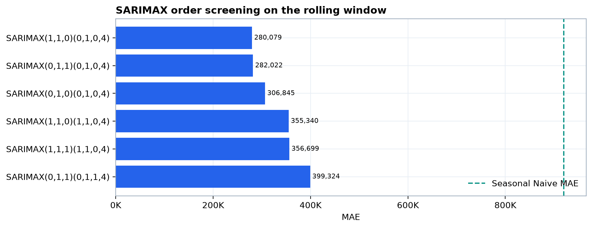

<div align="center"><b>Figure 31:</b> Rolling-origin MAE of alternative SARIMAX orders<br><i>(file: figures/Figure_31_SARIMAX_Order_Screening.png)</i></div>

## 6.6 FUTURE FORECASTS

### 6.6.1 SARIMAX eight-quarter forecast

Figure 32 shows the selected model's forecast for 2026 Q3 – 2028 Q2 with its 95% prediction interval. The point forecast keeps the seasonal pattern, with peaks in Q4, but drifts slightly downward. The interval widens quickly, and its lower bound falls below zero from 2027 Q3 onward, which is impossible for a passenger count.

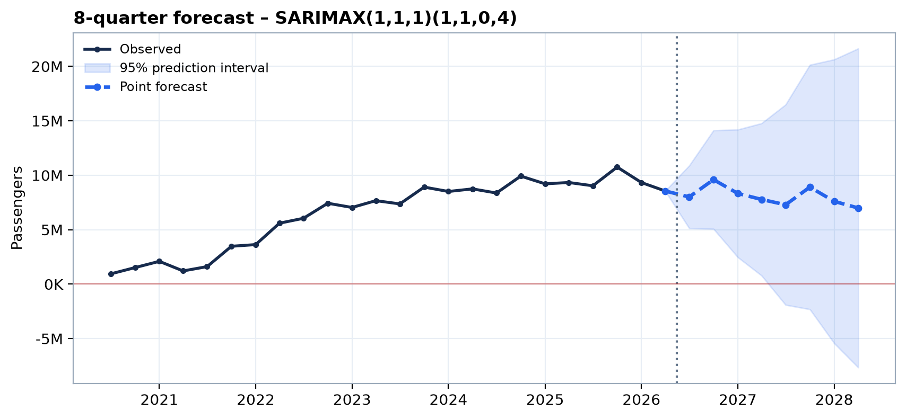

<div align="center"><b>Figure 32:</b> Eight-quarter forecast from SARIMAX(1,1,1)(1,1,0,4) with 95% prediction interval<br><i>(file: figures/Figure_32_Future_Forecast_SARIMAX.png)</i></div>

### 6.6.2 Log-scale SARIMAX forecast

Figure 33 shows the same model fitted to log values. Its bounds stay positive by construction, but the interval is extremely asymmetric. The 2020 collapse is a fall of more than 3 on the log scale, which inflates the estimated variance, and the upper bound grows very rapidly.

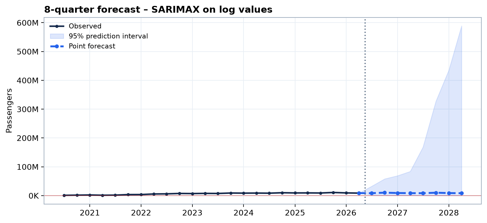

<div align="center"><b>Figure 33:</b> Eight-quarter forecast from SARIMAX fitted to log values, with 95% prediction interval<br><i>(file: figures/Figure_33_Future_Forecast_Log_SARIMAX.png)</i></div>

### 6.6.3 Comparison of model forecasts

Figure 34 compares the point forecasts of the four future-capable models. Seasonal Naive and the operational exogenous SARIMAX repeat the last year's seasonal pattern at roughly the current level. SARIMAX follows the pattern with a slight decline, and VAR predicts a lower, almost flat path.

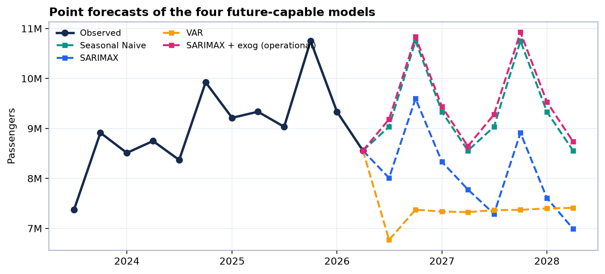

<div align="center"><b>Figure 34:</b> Comparison of eight-quarter point forecasts from the four future-capable models<br><i>(file: figures/Figure_34_Future_Forecast_Model_Comparison.png)</i></div>

### 6.6.4 Growth of forecast uncertainty

Figure 35 plots the width of each model's 95% interval as a percentage of its point forecast. The SARIMAX interval grows from 72% of the forecast one quarter ahead to 419% eight quarters ahead. The operational exogenous model's interval remains narrow only because it ignores the uncertainty of the projected regressors.

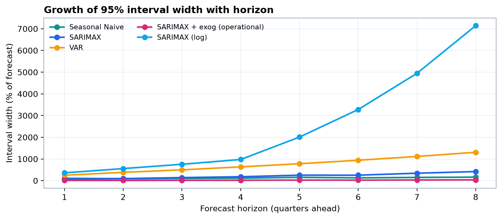

<div align="center"><b>Figure 35:</b> Width of the 95% prediction interval relative to the point forecast, by horizon<br><i>(file: figures/Figure_35_Interval_Width_by_Horizon.png)</i></div>

## 6.7 RESIDUAL DIAGNOSTICS

Figure 36 presents the in-sample residual diagnostics of the selected SARIMAX model: the residuals over time, their histogram, a normal Q-Q plot and the residual ACF. Apart from the 2020–2022 shocks, the residuals scatter randomly around zero, and no residual autocorrelation crosses the significance band. The heavy tails visible in the Q-Q plot come from the pandemic quarters.

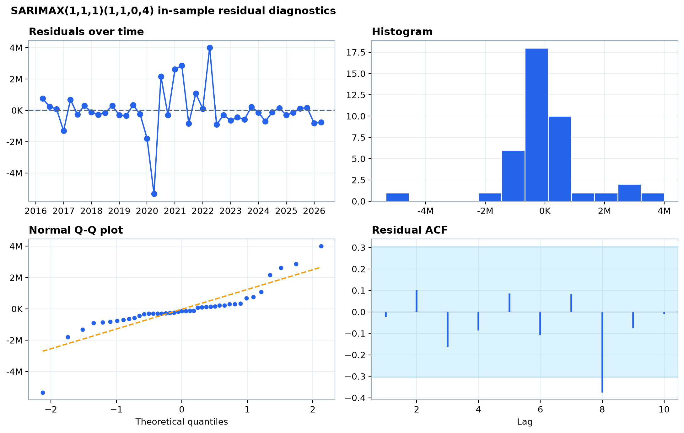

<div align="center"><b>Figure 36:</b> In-sample residual diagnostics of SARIMAX(1,1,1)(1,1,0,4)<br><i>(file: figures/Figure_36_SARIMAX_Residual_Diagnostics.png)</i></div>

Figure 37 shows the out-of-sample counterpart: the 12 rolling forecast errors of SARIMAX. They are small relative to traffic of 8–11 million per quarter, roughly symmetric, and mostly negative, a mild over-prediction that is examined in Section 7.8.

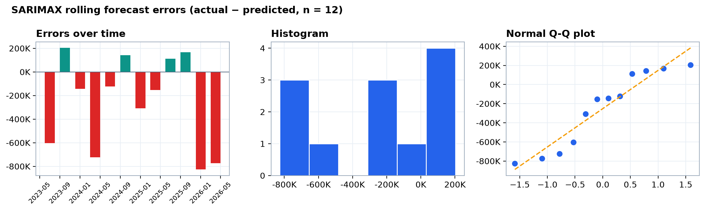

<div align="center"><b>Figure 37:</b> Diagnostics of SARIMAX rolling-origin forecast errors<br><i>(file: figures/Figure_37_SARIMAX_Rolling_Error_Diagnostics.png)</i></div>

## 6.8 INTERACTIVE DASHBOARD

The complete analysis is delivered as a ten-page Streamlit web application. A dark navy sidebar, present on every page, shows the project title, a dataset status card (file, source, coverage, number of quarters, variables and countries, latest-quarter status, last refresh time), grouped navigation links, the data filters (from/to quarter and countries), the forecast settings (target variable, horizon, confidence level, seasonal period) and a *Reload dataset* button. Table 11 lists the pages and their functions, and Figures 38–46 show them as rendered in a web browser.

<div align="center"><b>Table 11:</b> Dashboard pages and functions</div>

| Page | Main functions |
|---|---|
| Executive Dashboard | Eight KPI cards (total arrivals, latest quarter by variable with year-over-year change, four-quarter growth, best model, forecast horizon); traffic trends; quarterly comparison; correlation heat map; actual vs predicted; model ranking; generated observations |
| Dataset Explorer | Choice of data source (local, quarterly aggregate, upload, remote refresh); row, column, coverage, country, missing-value and duplicate counts; data-quality report; excluded records; filtered tables with readable labels; CSV downloads |
| Exploratory Analysis | Passenger and freight tabs (trends with moving averages, QoQ/YoY growth with small-base flags, annual totals, seasonality); statistical summary with KPI cards; correlation (Pearson/Spearman, levels/log changes); decomposition with strength measures; country breakdown |
| Time-Series Diagnostics | ADF table for selected variables and transformations; generated interpretation; ACF/PACF with adjustable lags; seasonal sub-series; Ljung–Box overview |
| Forecasting Laboratory | Model selector; SARIMAX orders and log option; VAR variables, transformation, lag limit and criterion with suitability checks; KPI cards (AIC, BIC, convergence); forecast chart and table; actual vs fitted; full model summary |
| Model Evaluation | Model, evaluation-size and metric selection; explanation of conditional vs operational modes; comparison table; MAE/RMSE/MAPE charts; actual vs predicted; per-quarter errors; error distribution; interpretation; SARIMAX screening; notebook results for comparison |
| Future Forecast | Model choice (default: best by rolling evaluation); forecast chart with interval and separator; table with interval widths; generated interpretation; validation checks; CSV, JSON, PNG and PDF downloads |
| Residual Analysis | In-sample residuals and rolling forecast errors in separate tabs: series, histogram, Q-Q plot, ACF, Ljung–Box, normality tests and small-sample warnings |
| Reports & Downloads | One-click report package: Markdown, PDF and JSON reports with 16 sections, ZIP of all outputs, chart-export status; library of the notebook's saved outputs |
| Project & Methodology | Aims, methodology steps, model differences, limitations, references and configuration |

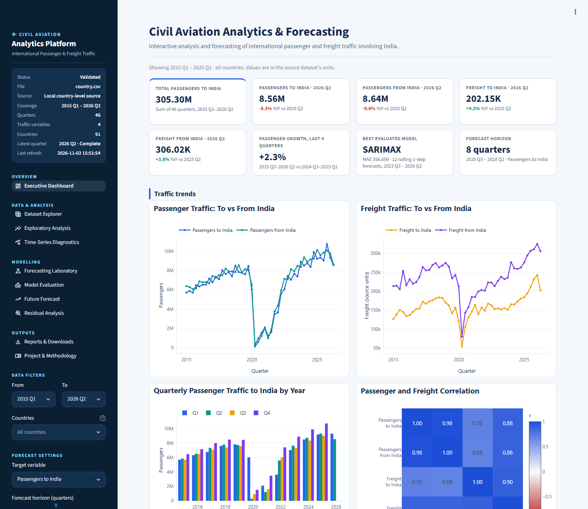

<div align="center"><b>Figure 38:</b> Dashboard – Executive Dashboard page<br><i>(file: figures/Figure_38_Dashboard_Executive_Dashboard.png)</i></div>

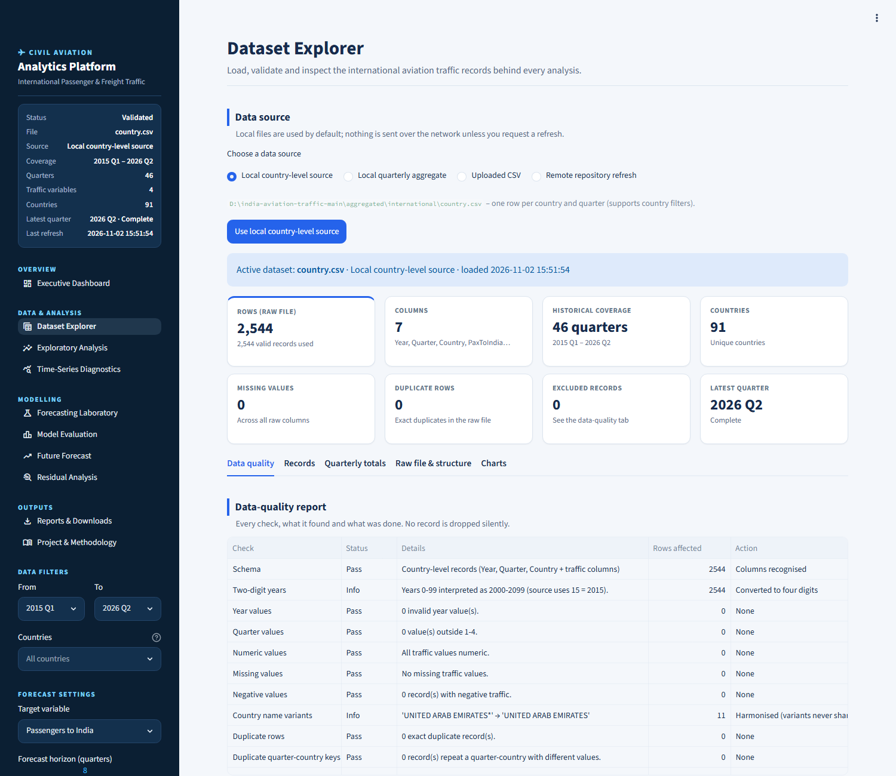

<div align="center"><b>Figure 39:</b> Dashboard – Dataset Explorer page<br><i>(file: figures/Figure_39_Dashboard_Dataset_Explorer.png)</i></div>

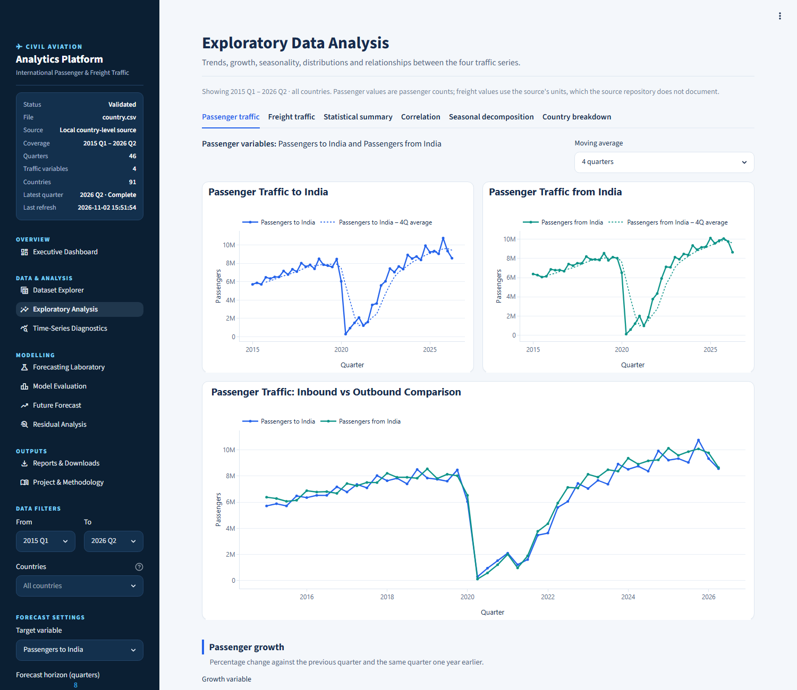

<div align="center"><b>Figure 40:</b> Dashboard – Exploratory Analysis page<br><i>(file: figures/Figure_40_Dashboard_Exploratory_Analysis.png)</i></div>

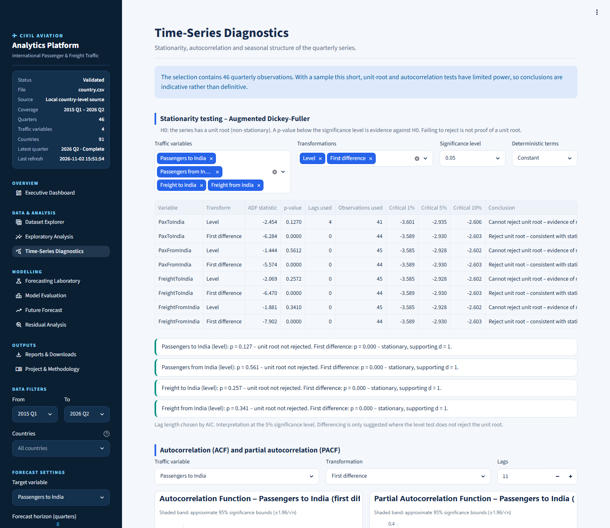

<div align="center"><b>Figure 41:</b> Dashboard – Time-Series Diagnostics page<br><i>(file: figures/Figure_41_Dashboard_Time_Series_Diagnostics.png)</i></div>

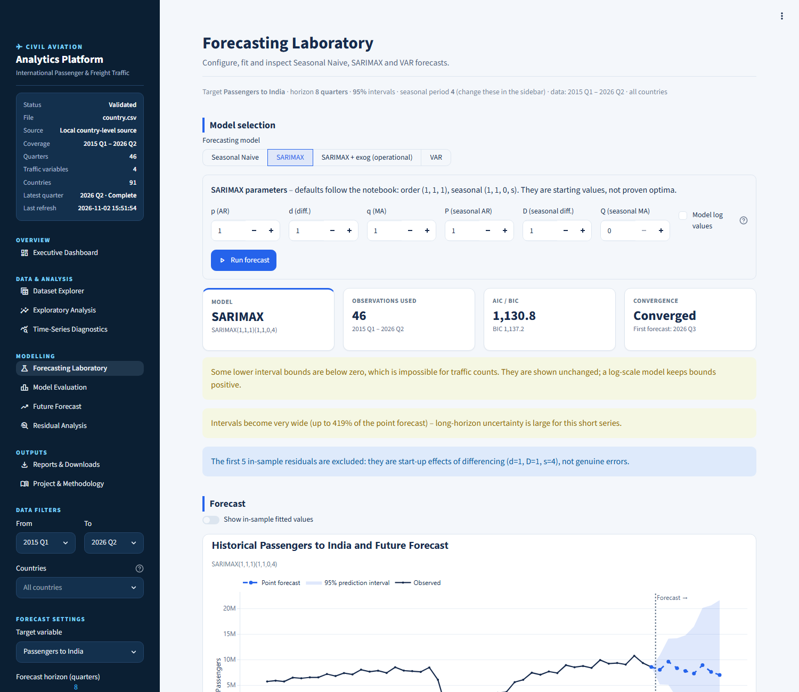

<div align="center"><b>Figure 42:</b> Dashboard – Forecasting Laboratory page<br><i>(file: figures/Figure_42_Dashboard_Forecasting_Laboratory.png)</i></div>

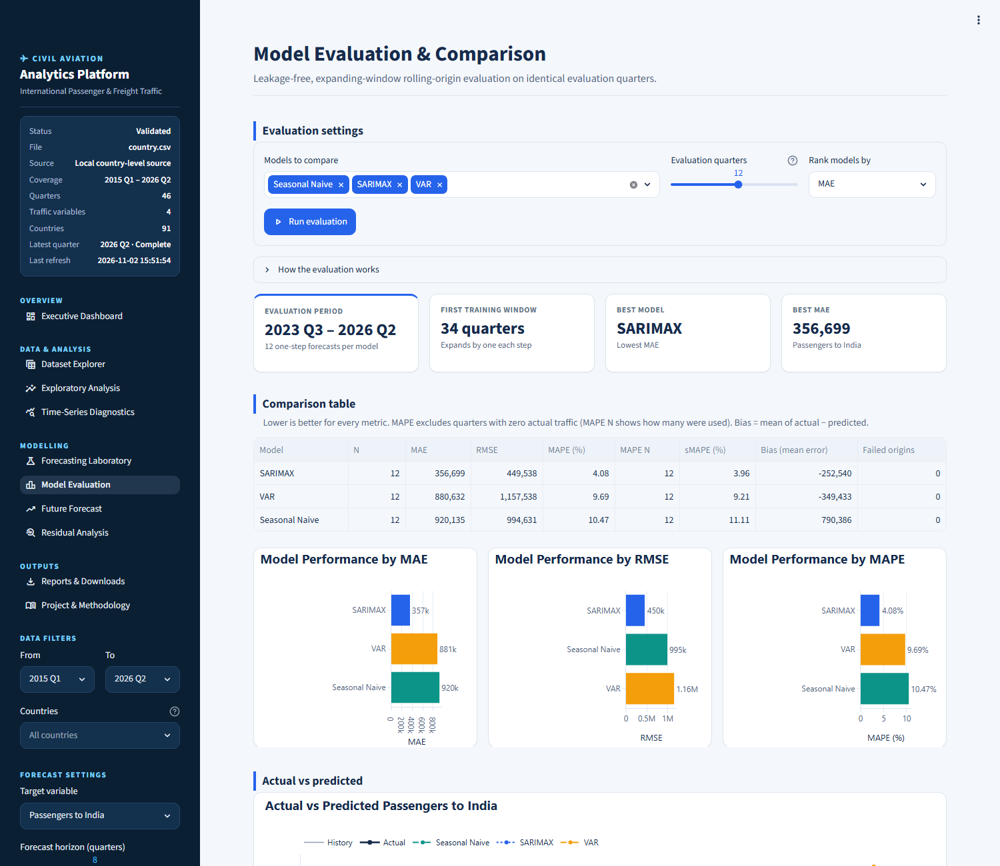

<div align="center"><b>Figure 43:</b> Dashboard – Model Evaluation page<br><i>(file: figures/Figure_43_Dashboard_Model_Evaluation.png)</i></div>

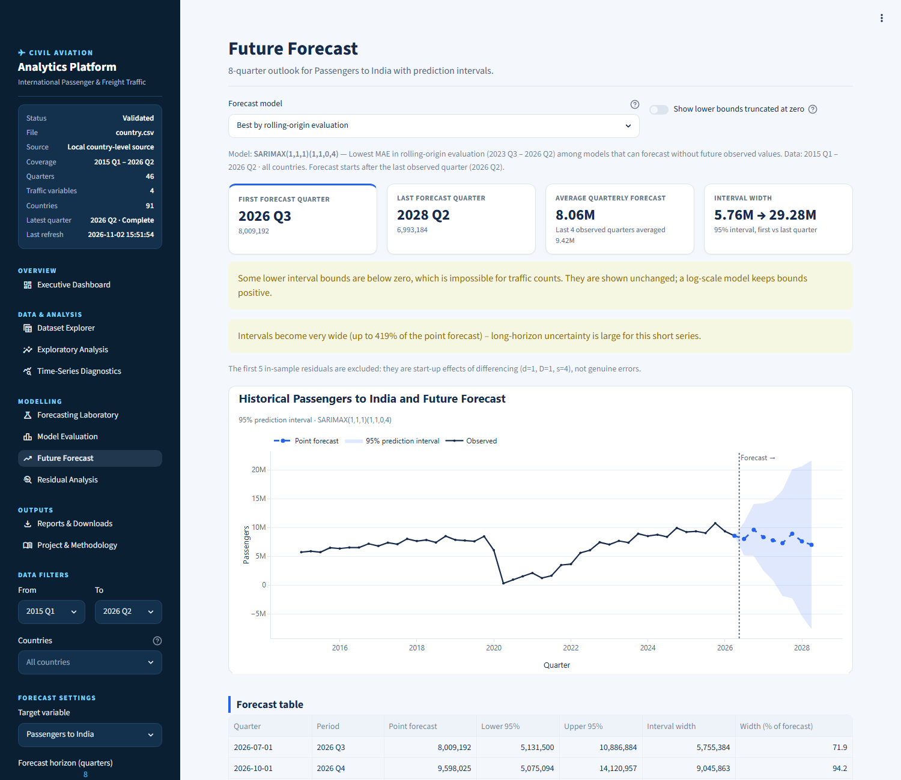

<div align="center"><b>Figure 44:</b> Dashboard – Future Forecast page<br><i>(file: figures/Figure_44_Dashboard_Future_Forecast.png)</i></div>

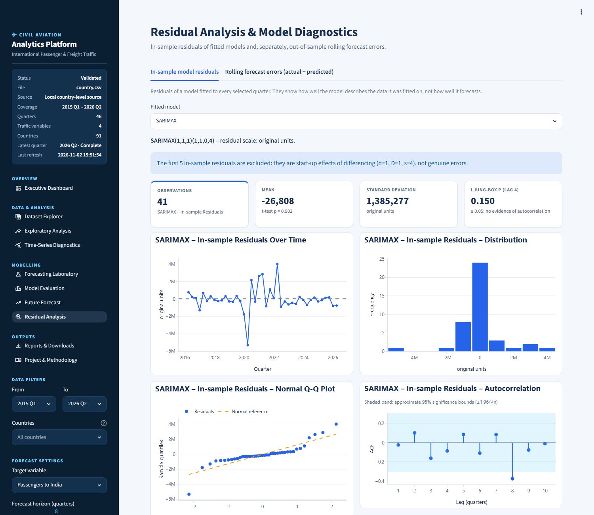

<div align="center"><b>Figure 45:</b> Dashboard – Residual Analysis page<br><i>(file: figures/Figure_45_Dashboard_Residual_Analysis.png)</i></div>

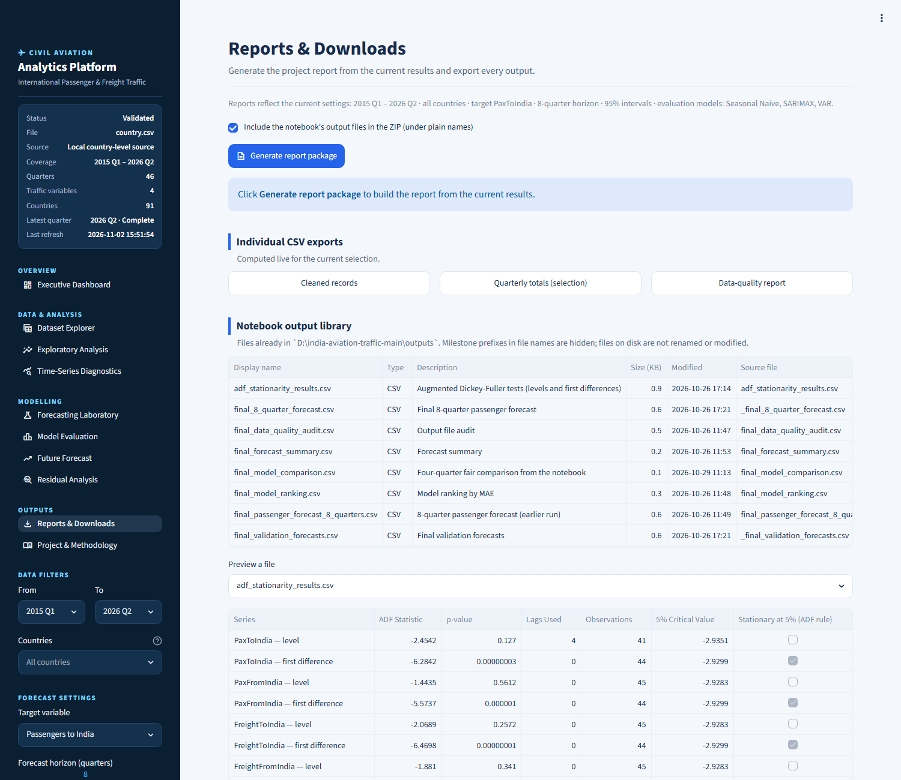

<div align="center"><b>Figure 46:</b> Dashboard – Reports & Downloads page<br><i>(file: figures/Figure_46_Dashboard_Reports_and_Downloads.png)</i></div>

<div style="page-break-after: always;"></div>
<div align="center" markdown="1">

# CHAPTER 7

# RESULTS AND DISCUSSION

</div>

This chapter reports the quantitative results behind the outputs of Chapter 6 and discusses what they mean. Sections 7.1–7.5 characterise the data, Sections 7.6–7.9 evaluate the models and the forecast, Section 7.10 checks the results against the earlier notebook, and Section 7.11 answers the research questions.

## 7.1 DATA QUALITY

The validation pipeline found the DGCA-derived source file to be of high quality (Table 7). All 2,544 records passed the schema, year, quarter, numeric, missing-value, negative-value and duplicate checks, and the 46 quarters form an unbroken sequence. Two documented interventions were needed. The two-digit years were converted to four digits, and the 11 records labelled "UNITED ARAB EMIRATES*" (2015–2019) were merged with "UNITED ARAB EMIRATES" (2017–2026). The two labels never report the same quarter, which suggests a change of label in the source rather than two different entities. Merging them matters for country-level analysis: the UAE is the largest origin market, and without the merge its series would have had only 35 of 46 quarters. National totals are unaffected, because every record is counted exactly once either way. The latest quarter, 2026 Q2, passed all four completeness checks, so it was used as a full observation.

## 7.2 TRENDS AND GROWTH

Table 12 gives the annual totals with year-over-year changes.

<div align="center"><b>Table 12:</b> Annual traffic totals, 2015 – 2026</div>

| Year | Passengers to India | Change | Passengers from India | Freight to India | Change | Freight from India | Change |
|---|---|---|---|---|---|---|---|
| 2015 | 23,781,640 | – | 24,858,956 | 560,737 | – | 887,775 | – |
| 2016 | 26,550,668 | +11.6% | 27,122,472 | 570,173 | +1.7% | 891,174 | +0.4% |
| 2017 | 29,257,716 | +10.2% | 29,683,857 | 667,222 | +17.0% | 1,013,108 | +13.7% |
| 2018 | 31,364,559 | +7.2% | 31,846,282 | 723,560 | +8.4% | 1,074,479 | +6.1% |
| 2019 | 31,662,661 | +1.0% | 32,515,548 | 630,122 | −12.9% | 1,016,861 | −5.4% |
| 2020 | 8,804,684 | −72.2% | 8,432,178 | 413,533 | −34.4% | 594,760 | −41.5% |
| 2021 | 8,399,498 | −4.6% | 8,639,901 | 605,439 | +46.4% | 772,187 | +29.8% |
| 2022 | 22,711,384 | +170.4% | 24,482,455 | 632,031 | +4.4% | 861,618 | +11.6% |
| 2023 | 30,994,436 | +36.5% | 32,887,452 | 613,252 | −3.0% | 932,838 | +8.3% |
| 2024 | 35,553,171 | +14.7% | 36,657,232 | 684,587 | +11.6% | 1,059,137 | +13.5% |
| 2025 | 38,334,313 | +7.8% | 39,645,623 | 821,462 | +20.0% | 1,188,354 | +12.2% |
| 2026* | 17,889,330 | – | 18,411,381 | 445,151 | – | 630,941 | – |

<i>*2026 contains only Q1 and Q2 and is not comparable with full years. Freight in source units.</i>

Four phases are clearly visible.

1. **Pre-pandemic growth (2015–2019).** Arrivals grew by 33.1% over four years, a compound annual growth rate of 7.4%, although growth slowed sharply in 2019 (+1.0%). Freight grew more slowly (compound annual growth of 3.0% inbound and 3.5% outbound) and fell in 2019.
2. **Collapse (2020–2021).** Arrivals fell 72.2% in 2020 and a further 4.6% in 2021. The quarterly low of 294,246 in 2020 Q2 is 95.1% below 2020 Q1. Freight fell far less (−34.4% inbound) and grew strongly again in 2021 (+46.4%), consistent with cargo continuing on freighter and passenger-cargo flights while passenger travel was restricted.
3. **Recovery (2022–2023).** Arrivals almost tripled in 2022 and reached 30.99 million in 2023, 2.1% below their 2019 level.
4. **New growth (2024–2026).** Arrivals rose 14.7% in 2024 and 7.8% in 2025, to 38.33 million, 21.1% above 2019. Outbound passengers show the same pattern (+21.9% versus 2019), and inbound freight has grown most strongly, ending 30.4% above 2019.

The most recent data show some softening. Arrivals in the first half of 2026 (17.89 million) are 3.6% below the first half of 2025, and 2026 Q2 is 8.3% below 2025 Q2. Two quarters are not enough to tell whether this is a temporary dip or a turning point, but it directly affects the forecast (Section 7.8).

Growth rates computed around the pandemic need care. The year-over-year change of +360.8% in 2022 Q2 and the quarter-over-quarter change of +220.9% in 2020 Q3 are arithmetically correct, but they are measured from quarters with traffic below a quarter of the series median. The analysis therefore flags eight quarters (2020 Q3 – 2022 Q3) as small-base growth rates rather than interpreting them as exceptional demand.

## 7.3 DISTRIBUTION AND SEASONALITY

Table 13 summarises the four quarterly series.

<div align="center"><b>Table 13:</b> Descriptive statistics of the quarterly traffic variables</div>

| Statistic | Passengers to India | Passengers from India | Freight to India | Freight from India |
|---|---|---|---|---|
| Count | 46 | 46 | 46 | 46 |
| Mean | 6,637,045 | 6,851,812 | 160,158 | 237,462 |
| Median | 7,363,806 | 7,503,107 | 156,863 | 236,594 |
| Standard deviation | 2,541,267 | 2,622,264 | 30,680 | 45,333 |
| Minimum | 294,246 | 116,849 | 54,119 | 80,025 |
| First quartile | 5,918,728 | 6,301,376 | 145,664 | 214,000 |
| Third quartile | 8,440,953 | 8,447,485 | 173,394 | 264,644 |
| Maximum | 10,752,640 | 10,127,507 | 243,002 | 324,925 |
| Skewness | −1.10 | −1.28 | −0.23 | −0.87 |
| Excess kurtosis | 0.55 | 0.92 | 3.29 | 2.27 |
| Coefficient of variation | 38.3% | 38.3% | 19.2% | 19.1% |

The passenger series are twice as variable as the freight series (coefficient of variation 38% against 19%) and strongly left-skewed: the medians exceed the means because of the long lower tail created by the pandemic quarters. Inbound freight has the highest excess kurtosis (3.29), reflecting a few extreme quarters within an otherwise narrow range.

Table 14 shows average arrivals by quarter of the year, over the whole period and over the two "normal" regimes.

<div align="center"><b>Table 14:</b> Average passengers to India by quarter of year</div>

| Quarter | All years (2015–2026) | Pre-pandemic (2015–2019) | Post-recovery (2022–2026) |
|---|---|---|---|
| Q1 (Jan–Mar) | 6,682,215 | 6,862,849 | 7,546,536 |
| Q2 (Apr–Jun) | 6,395,879 | 7,066,962 | 7,981,312 |
| Q3 (Jul–Sep) | 6,154,312 | 6,863,781 | 7,705,772 |
| Q4 (Oct–Dec) | **7,333,591** | **7,729,857** | **9,255,076** |

The fourth quarter is the peak in every regime. Before the pandemic Q4 was 11.5% above the average of the other three quarters; after the recovery the gap widened to 19.5%. The low point moved from Q1/Q3 (pre-pandemic) to Q1 (post-recovery), but the differences among Q1–Q3 are small. Table 15 shows the classical decomposition, which assigns seasonal effects of +679,797 (Q4), +62,751 (Q1), −314,658 (Q2) and −427,889 (Q3) passengers to the quarters.

<div align="center"><b>Table 15:</b> Seasonal decomposition summary (additive, period 4)</div>

| Series | Trend strength $F_T$ | Seasonal strength $F_S$ | Q1 index | Q2 index | Q3 index | Q4 index |
|---|---|---|---|---|---|---|
| Passengers to India | 0.95 | 0.39 | +62,751 | −314,658 | −427,889 | +679,797 |
| Freight to India | 0.86 | 0.06 | −547 | −2,941 | −788 | +4,276 |

Arrivals combine a dominant trend (0.95) with moderate seasonality (0.39). The seasonal strength is depressed by the large pandemic residuals: those quarters inflate the variance of the remainder, which lowers $F_S$, so the seasonality of normal years is stronger than this figure suggests. Inbound freight is essentially non-seasonal (0.06).

## 7.4 RELATIONSHIPS BETWEEN THE SERIES AND COUNTRY COMPOSITION

<div align="center"><b>Table 16:</b> Pearson correlation matrix (levels / quarter-over-quarter log changes)</div>

| | Passengers to India | Passengers from India | Freight to India | Freight from India |
|---|---|---|---|---|
| Passengers to India | 1 | 0.98 / 0.97 | 0.70 / 0.83 | 0.88 / 0.89 |
| Passengers from India | 0.98 / 0.97 | 1 | 0.69 / 0.81 | 0.88 / 0.90 |
| Freight to India | 0.70 / 0.83 | 0.69 / 0.81 | 1 | 0.90 / 0.89 |
| Freight from India | 0.88 / 0.89 | 0.88 / 0.90 | 0.90 / 0.89 | 1 |

All pairs are strongly and positively associated (Table 16). The correlation of arrivals with departures (0.98) shows that inbound and outbound passenger flows are two sides of largely the same travel: tourists and non-resident Indians make return journeys. The question raised in Chapter 1 (RQ4) is whether these correlations reflect only a shared long-run trend. After removing the trend by taking log changes, the correlations barely fall, and those involving inbound freight even rise (0.70 → 0.83). The series therefore move together from one quarter to the next. A large part of this co-movement, however, comes from the common pandemic shock, and the Spearman rank correlations (0.73–0.94) confirm that the association is not driven by a handful of extreme values alone. Correlation does not establish causation, and these results are not interpreted causally.

<div align="center"><b>Table 17:</b> Top 15 countries by passengers to India (2015 Q1 – 2026 Q2)</div>

| Rank | Country | Passengers to India | Share |
|---|---|---|---|
| 1 | United Arab Emirates | 96,886,633 | 31.7% |
| 2 | Singapore | 21,319,241 | 7.0% |
| 3 | Saudi Arabia | 19,000,176 | 6.2% |
| 4 | Thailand | 18,508,869 | 6.1% |
| 5 | Qatar | 18,024,029 | 5.9% |
| 6 | United Kingdom | 14,286,336 | 4.7% |
| 7 | Oman | 13,955,465 | 4.6% |
| 8 | Malaysia | 13,145,296 | 4.3% |
| 9 | Sri Lanka | 10,277,504 | 3.4% |
| 10 | Germany | 7,190,416 | 2.4% |
| 11 | Kuwait | 6,915,343 | 2.3% |
| 12 | United States | 6,730,570 | 2.2% |
| 13 | Bahrain | 5,929,818 | 1.9% |
| 14 | Hong Kong | 5,627,423 | 1.8% |
| 15 | Nepal | 4,935,702 | 1.6% |

Arrivals are concentrated in a small number of markets (Table 17). The Gulf countries (UAE, Saudi Arabia, Qatar, Oman, Kuwait and Bahrain) together supply 52.6% of all passengers to India, consistent with the large Indian workforce in the region and the hub role of Gulf airports. The top five markets supply 56.9%. The share of the UAE has fallen from 32.5% (2015 Q1) to 26.9% (2026 Q2), while Thailand's has risen from 5.2% to 8.2%. This high concentration means that a shock to a few Gulf corridors would move national traffic substantially. The current models cannot capture this risk, because they work with national totals only.

## 7.5 STATIONARITY AND AUTOCORRELATION

<div align="center"><b>Table 18:</b> Augmented Dickey–Fuller test results (constant only; 5% critical value ≈ −2.93)</div>

| Variable | Level: stat. (p) | First difference: stat. (p) | Seasonal difference: stat. (p) | Log first difference: stat. (p) |
|---|---|---|---|---|
| Passengers to India | −2.454 (0.127) | −6.284 (<0.001) | −2.828 (0.054) | −7.612 (<0.001) |
| Passengers from India | −1.444 (0.561) | −5.574 (<0.001) | −2.618 (0.089) | −7.957 (<0.001) |
| Freight to India | −2.069 (0.257) | −6.470 (<0.001) | −2.671 (0.079) | −7.607 (<0.001) |
| Freight from India | −1.881 (0.341) | −7.902 (<0.001) | −2.831 (0.054) | −8.710 (<0.001) |

The ADF results (Table 18) are consistent across the four series:

- **Levels:** the unit-root hypothesis cannot be rejected for any series (p = 0.127 to 0.561). Including a linear trend in the test regression does not change this conclusion (p = 0.327, 0.806, 0.398 and 0.557).
- **First differences:** the unit root is rejected decisively for every series (p < 0.001), so each series behaves as integrated of order one, I(1).
- **Seasonal differences alone** are borderline (p = 0.054 to 0.089) and do not achieve stationarity at the 5% level.
- **Log first differences** are clearly stationary (p < 0.001), which justifies the transformation used by the VAR model.

The ACF analysis agrees. In levels, the ACF of arrivals decays slowly (0.88, 0.74, 0.59, 0.49, 0.30 at lags 1–5), with significant values at lags 1–5 and 10–12, the hallmark of a non-stationary series. After first differencing, every autocorrelation except lag 4 lies inside the ±0.29 significance band. At lag 4 the ACF is 0.33 and the PACF 0.34, showing that a seasonal dependence remains after regular differencing. Together these results support the SARIMAX structure: one regular difference ($d = 1$), a seasonal component at period 4, and a seasonal difference ($D = 1$) to remove the stable annual pattern.

## 7.6 MODEL ESTIMATION

Table 19 reports the SARIMAX(1,1,1)(1,1,0,4) model estimated on all 46 quarters. The optimiser converged.

<div align="center"><b>Table 19:</b> Estimated SARIMAX(1,1,1)(1,1,0,4) parameters (full sample)</div>

| Parameter | Estimate | Interpretation |
|---|---|---|
| $\phi_1$ (AR, lag 1) | 0.385 | Moderate persistence of quarter-to-quarter changes |
| $\theta_1$ (MA, lag 1) | −0.173 | Partial correction of the previous quarter's shock |
| $\Phi_1$ (seasonal AR, lag 4) | −0.263 | Partial reversal of last year's seasonal change |
| $\sigma^2$ | 2.156 × 10¹² | Innovation standard deviation ≈ 1.47 million passengers |
| Log-likelihood based AIC / BIC | 1130.85 / 1137.18 | Used for comparison of SARIMAX variants only |

The innovation standard deviation of about 1.47 million passengers is large compared with the typical quarter-to-quarter variation seen in normal periods. This is because the 2020–2022 shocks are treated as ordinary innovations. It is also the reason why the model's long-horizon prediction intervals are wide (Section 7.8).

For the VAR, the sample-size rule (Section 4.1.10) allows at most one lag. With 45 log-differenced observations and four variables, a second lag would leave fewer than five observations per coefficient. All four log-differenced series are stationary (ADF p < 0.001), so the VAR(1) on log differences is statistically valid. This specification is also the one used in the original notebook.

## 7.7 ROLLING-ORIGIN EVALUATION

Table 20 is the central result of the project. All five model variants were evaluated with one-step forecasts on the same 12 quarters (2023 Q3 – 2026 Q2). The first training window contained 34 quarters, and no model failed at any origin.

<div align="center"><b>Table 20:</b> Rolling-origin evaluation metrics of all models (12 one-step forecasts, 2023 Q3 – 2026 Q2)</div>

| Model | MAE | RMSE | MAPE | sMAPE | Bias (actual − predicted) | MAE vs Seasonal Naive |
|---|---|---|---|---|---|---|
| **SARIMAX(1,1,1)(1,1,0,4)** | **356,699** | **449,538** | **4.08%** | **3.96%** | −252,540 | **−61.2%** |
| SARIMAX + exog (operational) | 821,123 | 924,268 | 9.32% | 9.87% | +697,888 | −10.8% |
| VAR(1) on log differences | 880,632 | 1,157,538 | 9.69% | 9.21% | −349,433 | −4.3% |
| Seasonal Naive (benchmark) | 920,135 | 994,631 | 10.47% | 11.11% | +790,386 | – |
| *SARIMAX + exog (conditional)†* | *201,148* | *265,164* | *2.24%* | *2.25%* | *+21,209* | *−78.1%* |

<i>†Uses the observed future values of the regressors; not achievable in real forecasting and excluded from model selection.</i>

**SARIMAX is the best operational model by a wide margin.** Its MAE of 356,699 passengers corresponds to an average error of 4.1% of quarterly traffic, and it reduces MAE by 61.2% and RMSE by 54.8% relative to the Seasonal Naive benchmark. It is the best of the operational models on every metric. Its errors stay below 3.4% in eight of the twelve quarters (Appendix B). The largest misses occur in 2023 Q3 (−8.2%), 2024 Q2 (−8.3%), 2026 Q1 (−8.9%) and 2026 Q2 (−9.0%), and they are all over-predictions. The last two coincide with the unexpected softening of traffic in 2026, which no model based only on past values could have anticipated.

**The Seasonal Naive benchmark is consistently too low.** Its bias of +790,386 means it under-predicts by about 0.8 million passengers per quarter. This is the expected behaviour of a method that repeats last year's value during a period of strong growth. Its error would shrink in a stable period, and it is exactly the kind of benchmark the M-competition literature recommends: hard to beat by accident, but beatable by a model that captures the trend.

**The VAR does not beat the benchmark in a meaningful way.** Its MAE is 4.3% lower than that of Seasonal Naive, but its RMSE is 16.4% higher, because it makes a few very large errors (for example +2.8 million over-prediction in 2026 Q1). With four variables and one lag, the VAR estimates 20 coefficients from only 32–43 effective observations per origin. It treats the extreme pandemic changes as information about how the series interact, and those dynamics carry over into its forecasts.

**Exogenous traffic variables help only when their future is known.** With the observed future values of departures and freight, SARIMAX reaches an MAE of 201,148, 43.6% better than the univariate SARIMAX. Without them, the operational variant (MAE 821,123) is 2.3 times worse than the univariate model and only slightly better than the benchmark. The explanation is that the projected regressors are themselves Seasonal Naive forecasts, so the model inherits the benchmark's systematic under-prediction (its bias of +697,888 is close to the benchmark's +790,386). This answers RQ6 clearly. The impressive accuracy of the notebook's original exogenous model came from the conditional set-up. For genuine forecasting, the other traffic series must first be forecast well, which is as hard as forecasting arrivals themselves.

### 7.7.1 SARIMAX order screening

<div align="center"><b>Table 21:</b> Rolling-origin MAE of alternative SARIMAX orders (same 12 quarters)</div>

| Configuration | MAE | RMSE | MAPE |
|---|---|---|---|
| SARIMAX(1,1,0)(0,1,0,4) | 280,079 | 378,459 | 3.20% |
| SARIMAX(0,1,1)(0,1,0,4) | 282,022 | 384,494 | 3.24% |
| SARIMAX(0,1,0)(0,1,0,4) | 306,845 | 427,894 | 3.56% |
| SARIMAX(1,1,0)(1,1,0,4) | 355,340 | 450,223 | 4.08% |
| SARIMAX(1,1,1)(1,1,0,4) (default) | 356,699 | 449,538 | 4.08% |
| SARIMAX(0,1,1)(0,1,1,4) ("airline" model) | 399,324 | 494,387 | 4.58% |

Every SARIMAX variant beats the benchmark by at least 56% in MAE, so the conclusion that a differenced seasonal ARIMA structure outperforms the alternatives is robust to the exact order (Table 21). The simplest variants, which have no seasonal AR or MA terms, perform best. SARIMAX(1,1,0)(0,1,0,4) reduces MAE by a further 21.5% relative to the default specification. This agrees with the general finding that parsimonious models generalise better on short series. However, the order was chosen *by* its performance on these same 12 quarters, so its score is optimistic. The default specification was fixed in advance and remains the honest headline result; the screening is reported as evidence for future work rather than as a replacement.

## 7.8 EIGHT-QUARTER FORECAST

The model selected automatically by the dashboard is the operational model with the lowest rolling MAE, SARIMAX(1,1,1)(1,1,0,4). It was refitted on all 46 quarters and produced the forecast in Table 22.

<div align="center"><b>Table 22:</b> Eight-quarter SARIMAX forecast of passengers to India (95% prediction interval)</div>

| Quarter | Point forecast | Lower 95% | Upper 95% | Interval width | Width (% of forecast) |
|---|---|---|---|---|---|
| 2026 Q3 | 8,009,192 | 5,131,500 | 10,886,884 | 5,755,384 | 71.9% |
| 2026 Q4 | 9,598,025 | 5,075,094 | 14,120,957 | 9,045,863 | 94.2% |
| 2027 Q1 | 8,331,296 | 2,471,830 | 14,190,763 | 11,718,933 | 140.7% |
| 2027 Q2 | 7,779,011 | 786,527 | 14,771,494 | 13,984,966 | 179.8% |
| 2027 Q3 | 7,291,234 | −1,903,684 | 16,486,151 | 18,389,835 | 252.2% |
| 2027 Q4 | 8,912,466 | −2,310,544 | 20,135,476 | 22,446,021 | 251.8% |
| 2028 Q1 | 7,604,631 | −5,422,235 | 20,631,498 | 26,053,733 | 342.6% |
| 2028 Q2 | 6,993,184 | −7,647,820 | 21,634,188 | 29,282,008 | 418.7% |

The point forecast keeps the established seasonal pattern, with Q4 peaks of 9.60 million (2026 Q4) and 8.91 million (2027 Q4). Its level, however, drifts downward: the first four forecast quarters total 33.72 million, 10.5% below the last four observed quarters (37.68 million). This decline is driven by the model's autoregressive response to the weak 2026 Q1 and Q2 observations, combined with the seasonal AR term. It should be read as a mechanical extrapolation of the most recent movement, not as a prediction that demand will contract. Recent history argues against a sustained decline: in the rolling evaluation, the largest SARIMAX errors were over-predictions following turning points, which shows that the model reacts strongly to the latest quarters.

**Uncertainty dominates beyond the first year.** The 95% interval is already ±2.9 million passengers one quarter ahead (72% of the forecast) and widens to ±14.6 million by 2028 Q2. From 2027 Q3 onward the lower bound is negative, which is impossible for passenger counts. This is a consequence of the model's normal, additive error assumption and of the very large innovation variance inherited from the pandemic quarters. The validation checks (Table 24) report it explicitly instead of hiding it.

Table 23 compares the point forecasts of all four future-capable models and of the log-scale SARIMAX.

<div align="center"><b>Table 23:</b> Point forecasts of all future-capable models (millions of passengers)</div>

| Quarter | SARIMAX | SARIMAX (log scale) | Seasonal Naive | SARIMAX + exog (operational) | VAR(1) |
|---|---|---|---|---|---|
| 2026 Q3 | 8.01 | 8.45 | 9.03 | 9.18 | 6.77 |
| 2026 Q4 | 9.60 | 10.11 | 10.75 | 10.83 | 7.37 |
| 2027 Q1 | 8.33 | 8.98 | 9.33 | 9.43 | 7.34 |
| 2027 Q2 | 7.78 | 8.51 | 8.56 | 8.64 | 7.33 |
| 2027 Q3 | 7.29 | 8.35 | 9.03 | 9.28 | 7.36 |
| 2027 Q4 | 8.91 | 9.98 | 10.75 | 10.93 | 7.37 |
| 2028 Q1 | 7.60 | 8.80 | 9.33 | 9.53 | 7.40 |
| 2028 Q2 | 6.99 | 8.25 | 8.56 | 8.74 | 7.41 |
| First four quarters, total | 33.72 | 36.06 | 37.68 | 38.10 | 28.81 |
| vs last four observed (37.68) | −10.5% | −4.3% | 0.0% | +1.1% | −23.5% |

The models disagree substantially about the level of traffic, from 28.8 to 38.1 million over the next four quarters, even though they agree that Q4 will be the peak. The log-scale SARIMAX lies between the level SARIMAX and the benchmark, and its bounds are positive. Its intervals, however, are extremely asymmetric (upper bound 589 million by 2028 Q2), because the 2020 collapse is an enormous change on the log scale. The operational exogenous model has narrow intervals (about ±0.6 million one quarter ahead) only because the uncertainty of its projected regressors is ignored; those intervals are not credible. This spread between plausible models is itself an important result. It shows that the next two years of traffic cannot be predicted from this history alone with the precision that a single point forecast might suggest.

<div align="center"><b>Table 24:</b> Forecast validation checks (SARIMAX forecast)</div>

| Check | Result | Details |
|---|---|---|
| Forecast horizon matches selection | Passed | 8 of 8 quarters |
| Forecast dates are consecutive quarters | Passed | 2026 Q3 to 2028 Q2 |
| No overlap with observed quarters | Passed | Last observed: 2026 Q2 |
| All values finite | Passed | – |
| Bounds ordered (lower ≤ forecast ≤ upper) | Passed | – |
| Point forecasts non-negative | Passed | – |
| Lower bounds non-negative | **Not passed** | Negative lower bounds from 2027 Q3 are kept as estimated and flagged |

## 7.9 RESIDUAL DIAGNOSTICS

<div align="center"><b>Table 25:</b> Residual and forecast-error diagnostic tests (SARIMAX)</div>

| Statistic | In-sample residuals (n = 41) | Rolling forecast errors (n = 12) |
|---|---|---|
| Mean | −26,808 | −252,540 |
| t-test of zero mean (p) | 0.902 | 0.046 |
| Standard deviation | 1,385,277 | 388,434 |
| Skewness | −0.40 | −0.36 |
| Excess kurtosis | 6.34 | −1.52 |
| Shapiro–Wilk (p) | < 0.001 | 0.096 |
| Jarque–Bera (p) | < 0.001 | 0.547 |
| Ljung–Box Q (p) | lag 4: 2.07 (0.150); lag 8: 10.91 (0.053) | lag 4: 4.72 (0.318) |

The **in-sample residuals** are centred on zero (p = 0.90) and show no significant autocorrelation at the 5% level (Ljung–Box p = 0.150 at lag 4 and 0.053 at lag 8). The model has therefore captured the linear dependence in the series, although the lag-8 result is borderline. The residuals are clearly not normal (Shapiro–Wilk and Jarque–Bera p < 0.001; excess kurtosis 6.3). The heavy tails come almost entirely from the 2020–2022 quarters, where the residuals reach −5.3 and +4.0 million. Since the model's prediction intervals assume normal errors, they are only approximate.

The **rolling forecast errors** behave differently. They show no autocorrelation (p = 0.318) and no evidence of non-normality (p = 0.096 and 0.547), but their mean of −252,540 is significantly different from zero at the 5% level (p = 0.046). In the post-recovery period, SARIMAX has tended to over-predict by about a quarter of a million passengers per quarter. Its differencing structure extrapolates the steep recovery trend slightly too far as growth decelerates. With only 12 values these tests have low power, and the conclusions are indicative. The pattern does suggest that a model allowing growth to slow down, such as a damped trend, could reduce this bias.

## 7.10 REPRODUCTION OF THE NOTEBOOK RESULTS

Before the dashboard was built, the project's analysis was carried out in a Jupyter notebook whose outputs were saved in the `outputs/` folder. Some of those files carried milestone prefixes in their names; the dashboard lists them under plain names. Table 26 compares the saved results with those produced by the new, tested code.

<div align="center"><b>Table 26:</b> Reproduction of the notebook results by the dashboard</div>

| Result (saved file) | Notebook value | Dashboard / thesis value | Status |
|---|---|---|---|
| Quarterly dataset (`quarterly_aviation_traffic.csv`) | 46 quarters | 46 quarters, identical values | Reproduced |
| Rolling SARIMAX MAE (`rolling_origin_model_metrics.csv`) | 356,699.23 | 356,699.23 | Reproduced |
| Rolling Seasonal Naive MAE (same file) | 920,134.83 | 920,134.83 | Reproduced |
| Rolling VAR MAE (`rolling_three_model_comparison.csv`) | 880,632.19 | 880,632.19 | Reproduced |
| Best screened SARIMAX, (1,1,0)(0,1,0,4) MAE (`sarimax_configuration_comparison.csv`) | 280,079.17 | 280,079.17 | Reproduced |
| SARIMAX 8-quarter forecast, 2026 Q3 (`final_passenger_forecast_8_quarters.csv`) | 8,009,192.09 | 8,009,192.09 | Reproduced |
| Log-SARIMAX forecast, 2026 Q3 (`log_sarimax_passenger_forecast.csv`) | 8,454,121.58 | 8,454,121.58 | Reproduced |
| Hold-out SARIMAX with exogenous variables, 80/20 split (`model_comparison.csv`) | MAE 344,677.64 vs Seasonal Naive 823,801.70 | Not used: conditional design, single split | Superseded |
| Four-quarter multi-step comparison (`final_model_comparison.csv`) | MAE 839,557.90 vs 1,139,683.75 | Not used: single forecast origin | Superseded |

Every result that the dashboard uses was reproduced exactly, which confirms that the refactoring into a tested package changed nothing in the statistics. Two early notebook results are superseded, not contradicted. The 80/20 hold-out evaluation used the observed test-period values of the exogenous variables, the conditional set-up of Section 4.1.9, and a single split. The four-quarter comparison used a single forecast origin. Both point in the same direction as the rolling evaluation (SARIMAX beats the benchmark), but the rolling-origin results are the more reliable basis for conclusions.

## 7.11 ANSWERS TO THE RESEARCH QUESTIONS

**RQ1 – Evolution of traffic.** International arrivals grew 33.1% between 2015 and 2019 (7.4% a year), collapsed by 72.2% in 2020 (95.1% within one quarter), recovered to the pre-pandemic level by 2023–2024, and reached a record 38.33 million in 2025, 21.1% above 2019. Freight fell much less (−34% inbound) and has grown fastest since, ending 30.4% above 2019. The first half of 2026 is 3.6% below the first half of 2025.

**RQ2 – Trend and seasonality.** The trend dominates (strength 0.95), and quarterly seasonality is moderate (0.39 overall, stronger in normal years). The fourth quarter is the clear peak, 19.5% above the average of the other quarters after the recovery. Freight shows almost no seasonality.

**RQ3 – Stationarity.** All four series are non-stationary in levels and stationary after first differencing (ADF p < 0.001), so they are I(1). A residual seasonal dependence at lag 4 justifies a seasonal component with period 4.

**RQ4 – Relationships.** Passenger and freight flows are strongly correlated (r = 0.70–0.98), and the association persists after removing the trend (r = 0.81–0.97 for log changes). The co-movement is genuine from quarter to quarter but is heavily influenced by the shared pandemic shock.

**RQ5 – Model comparison.** Under leakage-free rolling-origin evaluation, SARIMAX(1,1,1)(1,1,0,4) clearly outperforms the Seasonal Naive benchmark (MAE −61.2%, MAPE 4.08% vs 10.47%). The VAR(1) does not meaningfully improve on the benchmark (MAE −4.3% but RMSE +16.4%).

**RQ6 – Value of exogenous variables.** The other traffic series improve accuracy substantially only if their future values are known (MAE 201,148). When they must be projected, the model performs much worse than univariate SARIMAX (MAE 821,123). For real forecasting, the univariate model is preferable.

**RQ7 – Outlook.** SARIMAX forecasts 8.01 million arrivals in 2026 Q3 and a Q4 peak of 9.60 million, with a gently declining level that reflects the soft first half of 2026. Uncertainty is large: the 95% interval spans 5.8 million passengers one quarter ahead and 29.3 million two years ahead, and the plausible models disagree on next year's total by up to 9.3 million passengers (28.8 to 38.1 million). The forecast is therefore most useful for the next two to four quarters and as a scenario band beyond that.

<div style="page-break-after: always;"></div>
<div align="center" markdown="1">

# CHAPTER 8

# LIMITATIONS

</div>

The results of this project should be read with the following limitations in mind.

1. **Short series.** The data contain 46 quarterly observations, of which 12 are used for evaluation. Parameter estimates, statistical tests and error metrics therefore carry considerable sampling uncertainty. With 12 evaluation quarters, small differences between closely ranked models are not statistically meaningful.

2. **Structural break.** The 2020–2021 collapse and recovery are not generated by the same process as the rest of the series. All models are fitted across this break and treat it as a sequence of very large random shocks. This inflates the estimated error variance, makes the in-sample residuals strongly non-normal, and widens the prediction intervals. No explicit intervention or regime variable was modelled, because the timing and shape of such a variable would be chosen after seeing the data.

3. **Approximate prediction intervals.** The SARIMAX intervals assume normal, additive errors. In this sample that assumption produces negative lower bounds from five quarters ahead, and the residual tests reject normality. The VAR intervals include shock uncertainty but not parameter-estimation uncertainty. The intervals of the operational exogenous model omit the uncertainty of the projected regressors and are therefore too narrow.

4. **Possible look-ahead in model selection.** The default SARIMAX order was taken from the earlier notebook, whose development also used the same data. The order-screening results (Table 21) are explicitly optimistic because they were selected on the evaluation quarters themselves.

5. **Recent bias.** The rolling forecast errors of SARIMAX have a statistically significant mean of about −250,000 passengers (p = 0.046). The model has over-predicted during the post-recovery slowdown, and the eight-quarter forecast reacts strongly to the weak first half of 2026.

6. **No external drivers.** The models use only the history of the traffic series. Macroeconomic conditions, exchange rates, fares, visa policy, bilateral air-service agreements, fuel prices and geopolitical events affect demand, but they were not included. This is partly for lack of consistent quarterly data and partly because their future values would themselves need to be forecast.

7. **National aggregate only.** Forecasts are made for national totals. Traffic is concentrated in a few markets (the Gulf supplies 52.6% of arrivals), and country-specific shocks are not modelled.

8. **Data definitions.** The analysis relies on the DGCA statistics as compiled in the source repository. The repository does not document the unit of freight, the treatment of transit passengers or any revisions to past data, so these properties were taken as given. Two country labels were merged on the evidence that they never overlap in time.

9. **Linear models only.** Non-linear and machine-learning methods were deliberately not used, because 46 observations are too few to train and validate them reliably. Their potential on longer or monthly data was not tested.

<div style="page-break-after: always;"></div>

<div align="center" markdown="1">

# CHAPTER 9

# CONCLUSION AND FUTURE WORK

</div>

## 9.1 CONCLUSION

This project set out to analyse India's international air traffic and to forecast quarterly passenger arrivals in a way that is fair, transparent and reproducible. All of its goals were achieved.

A validated quarterly dataset was built from 2,544 country-level DGCA records. Every cleaning decision was reported, and the only interventions were the conversion of two-digit years and the documented merging of two labels for the United Arab Emirates. The exploratory analysis quantified a decade of change: arrivals grew 33.1% from 2015 to 2019, collapsed by 72.2% in 2020, and recovered to a record 38.33 million in 2025, 21.1% above the pre-pandemic level. Traffic peaks in the fourth quarter, is dominated by its trend, is closely linked to outbound passengers and to freight, and is concentrated in Gulf markets.

The statistical tests showed that every series is integrated of order one with a residual annual seasonal dependence. This directly motivated a seasonal ARIMA structure with one regular and one seasonal difference. In a leakage-free rolling-origin evaluation over the 12 most recent quarters, SARIMAX(1,1,1)(1,1,0,4) achieved an MAE of 356,699 passengers (MAPE 4.08%), 61.2% lower than the Seasonal Naive benchmark. A VAR(1) on log differences and a SARIMAX with projected exogenous regressors improved on the benchmark only marginally. A SARIMAX given the observed future regressors was the most accurate model, but this conditional accuracy is not available in practice. This distinction, which the earlier notebook evaluation did not make, is one of the main methodological lessons of the project: exogenous variables add value only if their own future values can be forecast well.

The eight-quarter forecast keeps the Q4 seasonal peak but lies below recent levels, reflecting the weaker first half of 2026. Its 95% interval widens from 5.8 million to 29.3 million passengers, and plausible models disagree by up to 9.3 million passengers on next year's total. The forecast is therefore most informative for the next few quarters, and it should be presented as a range rather than a single number.

Finally, the whole workflow was delivered as a modular Python package and a ten-page Streamlit dashboard. The dashboard validates and explores the data, runs the diagnostics, fits and compares models, produces forecasts and residual analyses, and generates PDF, Markdown and JSON reports. It reproduces every saved notebook result exactly and is verified by 73 automated tests. Every number in this thesis was produced by the same code and can be regenerated from the source data with one command.

## 9.2 FUTURE WORK

The following extensions would strengthen the analysis.

- **Intervention and regime modelling.** Add explicit pandemic intervention variables, or estimate the models only on pre-2020 and post-2022 data, to obtain cleaner seasonal estimates and narrower, more credible intervals.
- **Damped-trend and exponential-smoothing models.** ETS models with a damped trend, and the simpler SARIMAX orders identified by the screening, could address the recent over-prediction bias. They should be evaluated on future quarters that were not used to select them.
- **Monthly data.** The source also contains monthly airline-level data. Aggregating it to a monthly national series would give three times as many observations and allow richer models.
- **Hierarchical forecasting.** Forecast the major country corridors (UAE, Saudi Arabia, Singapore and others) individually and reconcile them with the national total, which would capture market concentration and corridor-specific shocks.
- **External drivers with forecastable futures.** Include scheduled seat capacity, exchange rates or tourism indicators, whose future values are published or can be forecast, and re-test the operational value of exogenous information.
- **Machine-learning benchmarks.** Compare gradient boosting or neural forecasting methods once longer or monthly data are available, using the same rolling-origin protocol.
- **Probabilistic evaluation.** Assess interval calibration and use proper scoring rules (for example the continuous ranked probability score) in addition to point-forecast errors.
- **Automated updates.** Schedule the dashboard to refresh the data each quarter, re-run the evaluation, and record how forecast accuracy evolves as new quarters arrive.

<div style="page-break-after: always;"></div>

<div align="center" markdown="1">

# REFERENCES

</div>

1. Box, G. E. P., Jenkins, G. M., Reinsel, G. C., & Ljung, G. M. (2015). *Time Series Analysis: Forecasting and Control* (5th ed.). Hoboken, NJ: Wiley.
2. Hyndman, R. J., & Athanasopoulos, G. (2021). *Forecasting: Principles and Practice* (3rd ed.). Melbourne: OTexts. https://otexts.com/fpp3/
3. Dickey, D. A., & Fuller, W. A. (1979). Distribution of the estimators for autoregressive time series with a unit root. *Journal of the American Statistical Association*, 74(366), 427–431.
4. Said, S. E., & Dickey, D. A. (1984). Testing for unit roots in autoregressive-moving average models of unknown order. *Biometrika*, 71(3), 599–607.
5. Ljung, G. M., & Box, G. E. P. (1978). On a measure of lack of fit in time series models. *Biometrika*, 65(2), 297–303.
6. Lütkepohl, H. (2005). *New Introduction to Multiple Time Series Analysis*. Berlin: Springer.
7. Sims, C. A. (1980). Macroeconomics and reality. *Econometrica*, 48(1), 1–48.
8. Tashman, L. J. (2000). Out-of-sample tests of forecasting accuracy: An analysis and review. *International Journal of Forecasting*, 16(4), 437–450.
9. Hyndman, R. J., & Koehler, A. B. (2006). Another look at measures of forecast accuracy. *International Journal of Forecasting*, 22(4), 679–688.
10. Makridakis, S., Spiliotis, E., & Assimakopoulos, V. (2018). Statistical and machine learning forecasting methods: Concerns and ways forward. *PLoS ONE*, 13(3), e0194889.
11. Makridakis, S., Spiliotis, E., & Assimakopoulos, V. (2020). The M4 Competition: 100,000 time series and 61 forecasting methods. *International Journal of Forecasting*, 36(1), 54–74.
12. Grubb, H., & Mason, A. (2001). Long lead-time forecasting of UK air passengers by Holt–Winters methods with damped trend. *International Journal of Forecasting*, 17(1), 71–82.
13. Tsui, W. H. K., Balli, H. O., Gilbey, A., & Gow, H. (2014). Forecasting of Hong Kong airport's passenger throughput. *Tourism Management*, 42, 62–76.
14. Dantas, T. M., Oliveira, F. L. C., & Repolho, H. M. V. (2017). Air transportation demand forecast through Bagging Holt Winters methods. *Journal of Air Transport Management*, 59, 116–123.
15. Gudmundsson, S. V., Cattaneo, M., & Redondi, R. (2021). Forecasting temporal world recovery in air transport markets in the presence of large economic shocks: The case of COVID-19. *Journal of Air Transport Management*, 91, 102007.
16. International Civil Aviation Organization (ICAO). *Effects of Novel Coronavirus (COVID-19) on Civil Aviation: Economic Impact Analysis*. Montréal: ICAO Air Transport Bureau. https://www.icao.int/sustainability/Pages/Economic-Impacts-of-COVID-19.aspx
17. Seabold, S., & Perktold, J. (2010). statsmodels: Econometric and statistical modeling with Python. In *Proceedings of the 9th Python in Science Conference* (pp. 92–96).
18. McKinney, W. (2010). Data structures for statistical computing in Python. In *Proceedings of the 9th Python in Science Conference* (pp. 56–61).
19. Hunter, J. D. (2007). Matplotlib: A 2D graphics environment. *Computing in Science & Engineering*, 9(3), 90–95.
20. Harris, C. R., Millman, K. J., van der Walt, S. J., et al. (2020). Array programming with NumPy. *Nature*, 585, 357–362.
21. Virtanen, P., Gommers, R., Oliphant, T. E., et al. (2020). SciPy 1.0: Fundamental algorithms for scientific computing in Python. *Nature Methods*, 17, 261–272.
22. Plotly Technologies Inc. (2015). *Collaborative data science*. Montréal, QC. https://plot.ly
23. Streamlit Inc. *Streamlit documentation*. https://docs.streamlit.io
24. Vonter. *india-aviation-traffic: Aviation traffic data for India* [Data set]. GitHub. https://github.com/Vonter/india-aviation-traffic
25. Directorate General of Civil Aviation, Government of India. *Traffic data*. https://www.dgca.gov.in
26. Cleveland, R. B., Cleveland, W. S., McRae, J. E., & Terpenning, I. (1990). STL: A seasonal-trend decomposition procedure based on loess. *Journal of Official Statistics*, 6(1), 3–73.
27. Akaike, H. (1974). A new look at the statistical model identification. *IEEE Transactions on Automatic Control*, 19(6), 716–723.
28. Schwarz, G. (1978). Estimating the dimension of a model. *The Annals of Statistics*, 6(2), 461–464.
29. Shapiro, S. S., & Wilk, M. B. (1965). An analysis of variance test for normality (complete samples). *Biometrika*, 52(3–4), 591–611.
30. Jarque, C. M., & Bera, A. K. (1980). Efficient tests for normality, homoscedasticity and serial independence of regression residuals. *Economics Letters*, 6(3), 255–259.
31. Wang, X., Smith, K., & Hyndman, R. (2006). Characteristic-based clustering for time series data. *Data Mining and Knowledge Discovery*, 13(3), 335–364.

<div style="page-break-after: always;"></div>

<div align="center" markdown="1">

# APPENDIX A

# DASHBOARD USER GUIDE

</div>

**Installation and launch (Windows).** Open a terminal in the project folder and run:

```bat
C:\Users\<user>\anaconda3\python.exe -m pip install -r requirements.txt
C:\Users\<user>\anaconda3\python.exe -m streamlit run app.py --server.headless true
```

Then open `http://localhost:8501` in a web browser. (In PowerShell, change folder with `cd D:\india-aviation-traffic-main`; the `/d` switch applies only to Command Prompt.)

**Choosing data.** On the *Dataset Explorer* page, choose the local country-level file (the default), the notebook's quarterly aggregate, an uploaded CSV (from any drive, up to 20 MB), or a refresh from the source repository. An uploaded file must contain the four traffic columns and either `Year` and `Quarter` (optionally `Country`) or `Date`. Invalid files are rejected with an explanation, and the previous dataset stays active. An upload lasts for the current browser session.

**Filtering.** The sidebar's *From* and *To* selectors restrict the quarters analysed, and the *Countries* selector restricts the partner countries (leave it empty for all). Every page uses the same filtered data. *Reload dataset* re-reads the local files and resets the filters.

**Forecast settings.** The sidebar also sets the target variable, the forecast horizon (1–16 quarters), the confidence level (80, 90, 95 or 99%) and the seasonal period. SARIMAX orders, the log option and the VAR settings are changed in the *Forecasting Laboratory*. The models to compare, the number of evaluation quarters and the ranking metric are changed on the *Model Evaluation* page. Every change triggers a fresh, cached computation.

**Reading results.** KPI cards summarise each page. Charts are interactive: hover for values, drag to zoom, and use the camera icon to save a PNG. Warnings in amber identify limitations, for example small-base growth rates, negative interval bounds or small samples. They should be read, not dismissed.

**Exporting.** The *Future Forecast* page downloads the forecast as CSV, JSON, PNG or PDF. The *Reports & Downloads* page generates the complete report (16 sections) as Markdown, PDF and JSON, together with a ZIP archive of all data, results, charts and the notebook's saved outputs. Evaluation results are also written to `outputs/dashboard_exports/`.

**Regenerating the thesis figures.** Run `python thesis/generate_figures.py` from the project folder. It recreates Figures 1–37 and `thesis/results.json` from the source data. Figures 38–46 are browser screenshots of the dashboard.

<div style="page-break-after: always;"></div>

<div align="center" markdown="1">

# APPENDIX B

# ROLLING-ORIGIN FORECASTS OF ALL MODELS

</div>

Table 27 lists every one-step forecast made in the rolling-origin evaluation, together with the training window used. It allows the metrics of Table 20 to be verified independently.

<div align="center"><b>Table 27:</b> Rolling-origin one-step forecasts of all models (passengers to India)</div>

| Quarter | Training window | Actual | Seasonal Naive | SARIMAX | VAR(1) | SARIMAX + exog (cond.) | SARIMAX + exog (oper.) |
|---|---|---|---|---|---|---|---|
| 2023 Q3 | 2015 Q1 – 2023 Q2 (34) | 7,369,804 | 6,050,154 | 7,973,515 | 7,254,963 | 7,320,151 | 6,119,333 |
| 2023 Q4 | 2015 Q1 – 2023 Q3 (35) | 8,913,959 | 7,430,008 | 8,710,264 | 7,651,689 | 8,306,753 | 7,097,843 |
| 2024 Q1 | 2015 Q1 – 2023 Q4 (36) | 8,510,818 | 7,042,996 | 8,654,515 | 8,351,492 | 8,233,406 | 7,245,843 |
| 2024 Q2 | 2015 Q1 – 2024 Q1 (37) | 8,749,019 | 7,667,677 | 9,472,835 | 8,654,781 | 8,959,478 | 8,038,177 |
| 2024 Q3 | 2015 Q1 – 2024 Q2 (38) | 8,369,638 | 7,369,804 | 8,492,530 | 9,293,707 | 8,411,451 | 7,753,967 |
| 2024 Q4 | 2015 Q1 – 2024 Q3 (39) | 9,923,696 | 8,913,959 | 9,781,977 | 9,148,115 | 10,044,978 | 9,145,378 |
| 2025 Q1 | 2015 Q1 – 2024 Q4 (40) | 9,212,963 | 8,510,818 | 9,520,598 | 10,404,152 | 9,616,470 | 8,795,101 |
| 2025 Q2 | 2015 Q1 – 2025 Q1 (41) | 9,335,219 | 8,749,019 | 9,489,587 | 9,125,274 | 9,588,189 | 8,898,291 |
| 2025 Q3 | 2015 Q1 – 2025 Q2 (42) | 9,033,491 | 8,369,638 | 8,920,425 | 9,901,366 | 9,065,934 | 8,321,144 |
| 2025 Q4 | 2015 Q1 – 2025 Q3 (43) | 10,752,640 | 9,923,696 | 10,586,163 | 10,181,645 | 10,769,796 | 9,834,964 |
| 2026 Q1 | 2015 Q1 – 2025 Q4 (44) | 9,332,607 | 9,212,963 | 10,159,049 | 12,152,654 | 9,016,986 | 9,139,748 |
| 2026 Q2 | 2015 Q1 – 2026 Q1 (45) | 8,556,723 | 9,335,219 | 9,329,595 | 10,133,933 | 8,472,472 | 9,296,134 |
| **MAE** | | | **920,135** | **356,699** | **880,632** | **201,148** | **821,123** |

<div align="center"><i>— End of Thesis —</i></div>
